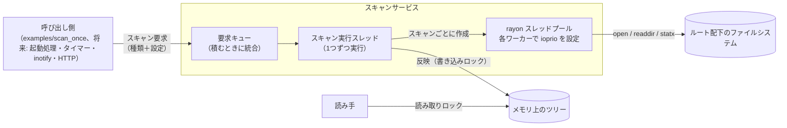
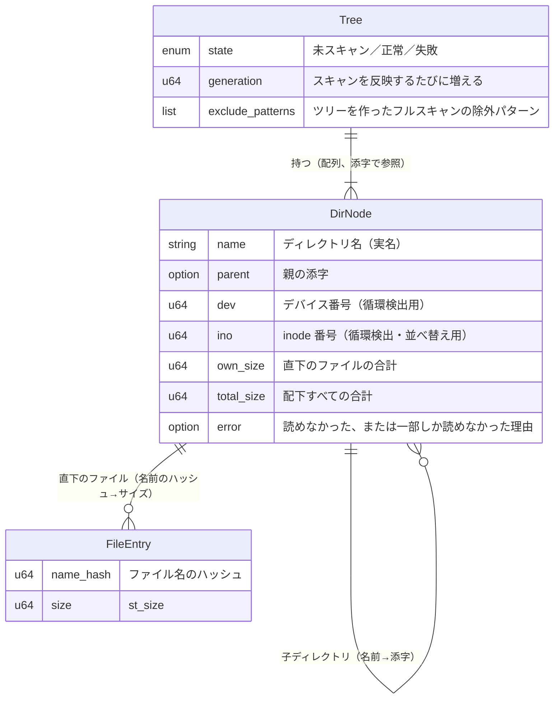
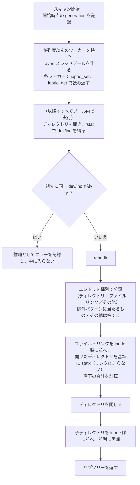

# ディレクトリスキャン 設計ドキュメント

## 1. Overview (概要)

suminoe_file_server が公開するディレクトリツリーについて、各ディレクトリ配下のファイルの合計サイズ（論理サイズ `st_size`）をメモリ上にキャッシュするための、ディレクトリスキャン機構を設計する。対象のルートディレクトリは1つで、スキャンはツリー全体を作り直す「フルスキャン」と、指定したサブツリーだけを読み直す「部分スキャン」の2種類を提供する。

スキャンの並列度・I/O 優先度・除外パターンは、スキャンを要求するたびに呼び出し側が指定する。設定はスキャンの開始時に確定し、実行中のスキャンには影響しない。走査では、#3 の計測でそれぞれ効果が確認できた並列走査と inode 順の走査を採用する（両者の組み合わせは未計測）。

サーバーへの組み込み（起動時のスキャン、定期スキャン、HTTP、inotify）はこの DD では行わず、スキャン機構を単体で動かして検証できるところまでを扱う。将来の inotify による差分更新（別 DD）がこのツリーをファイル単位で更新できるよう、ファイルごとに「名前のハッシュ＋サイズ」を保持する。

## 2. Context (背景)

- 本サーバーの目的の1つは、共有フォルダ（sugaga の `/mnt/vgmd0/srv/share`、ディレクトリ 164,717／ファイル約 1,675,021）について、ディレクトリごとの合計サイズを即座に返すことである。リクエストのたびに走査すると、キャッシュが冷えた状態では数十秒〜数分かかる（#3）。
- #3 の計測で分かっていること：
  - キャッシュが冷えた状態の走査時間は、ほぼ HDD（RAID-6、4台）の待ち時間で決まる。`orig` と GNU find はほぼ同じ時間で、コードの書き方による差はほとんどない。
  - 並列化は効く。並列度 4〜8 で orig 比約 49% 短縮し、16 では悪化してばらつきも大きくなる。
  - 子を inode 番号順に辿ると約 18% 短縮する（逐次での計測）。並列化と inode 順を組み合わせた場合は計測していない。
  - ext4 の `filetype` 機能により、readdir の時点でエントリの種別が分かる。種別を知るためだけの stat は不要。
  - キャッシュの状態や、同じ `md0` を使う他の LV の I/O によって、走査時間がバッチ間で大きく変動する（同じ `orig` で 78.7〜122.8 秒）。比較は同じバッチ内で行う必要がある。
- これまでの計測はディレクトリだけを対象にしていた。サイズを得るにはファイルごとに stat（inode の読み込み）が必要で、その分の I/O が新たに加わる。
- 同じ RAID を CI のキャッシュ（`gitlab-runner-cache`）なども使っているため、将来の定期スキャンは低い並列度と idle の I/O 優先度で、起動時のスキャンは高い並列度で動かしたい。用途によって設定を変えられる必要がある。
- inotify による監視（#2）はこの DD の対象外だが、そこでのイベントを反映できる受け口（部分スキャン、ファイル単位のサイズ保持、`generation`）は、この DD で用意しておく必要がある。

## 3. Scope (範囲)

### 変更対象ファイル

| ファイル | 役割・変更理由 |
|---|---|
| `Cargo.toml` | `rayon`・`globset`・`anyhow`・`log`・`env_logger`・`libc` を追加し、開発用に `tempfile` を追加する。バージョンはパッチまで固定する（既存の `actix-web = "4"` も固定する）。`[profile.release] debug = 1` を追加する |

### 新規追加ファイル

| ファイル | 役割 |
|---|---|
| `src/lib.rs` | `dir_scan` モジュールをライブラリとして公開する。`examples/` から使うには、バイナリではなくライブラリのクレートにある必要があるため |
| `src/dir_scan/mod.rs` | スキャンサービス（要求キュー、スキャン実行スレッド）と、外部に公開する操作 |
| `src/dir_scan/settings.rs` | スキャン設定（並列度・I/O 優先度・除外パターン）の型と検証 |
| `src/dir_scan/request.rs` | 要求の検証（パスの正規化）と統合規則。ファイルシステムに触れない純粋なロジック |
| `src/dir_scan/tree.rs` | メモリ上のツリー（データモデル）と、スキャン結果の反映・サイズの伝播 |
| `src/dir_scan/walk.rs` | 1 回のスキャンの走査処理（並列走査、inode 順、除外、循環検出、エラーの記録） |
| `src/dir_scan/ioprio.rs` | ワーカースレッドへの I/O 優先度の設定と読み返し（`ioprio_set`／`ioprio_get`） |
| `examples/scan_once.rs` | 動作確認・検証用のプログラム。ルートと設定を引数で受け取り、スキャンを1回実行して、レポートとディレクトリごとの合計を出力する |
| `doc/design/20261101_dir_scan_design.md` | 本 DD |

### 変更対象外

| ファイル | 理由 |
|---|---|
| `src/main.rs` | サーバーへの組み込み（起動時のスキャン、HTTP からの参照）は別 DD で扱う |

## 4. Goal (目標)

- **フルスキャンで正しいツリーを構築できる**：ディレクトリごとの直下のファイル合計（`own_size`）が、スキャナと同じユーザーで実行した次のコマンドの、ディレクトリ別の総和と一致する。合成ツリーでは完全一致し、sugaga では利用の少ない時間帯に実行して、差が出たディレクトリが再実行で一致することを確認する。
  ```sh
  find <root> -name '.*' -prune -o \( -type f -o -type l \) -printf '%h\t%s\n'
  ```
- **部分スキャンでサブツリーを差し替えられる**：ファイルを変更してから部分スキャンした結果（祖先の合計を含む）が、同じ状態でフルスキャンした結果と一致する。
- **並列度と I/O 優先度を要求ごとに指定できる**：指定した並列度でワーカースレッドが作られ、各ワーカーで `ioprio_get` により読み返した I/O 優先度がレポートに記録され、指定値と一致する。設定に失敗した場合は、失敗がレポートに残る。
- **キャッシュが冷えた状態でも実用的な時間でフルスキャンできる**：sugaga で、逐次の `du -sb` と `scan_once`（並列度 4）を同じバッチ内で交互に3回ずつ、毎回 `sync; echo 3 | sudo tee /proc/sys/vm/drop_caches` してから実行し、中央値で `scan_once` のほうが短い。

## 5. Non-Goal (目標外)

- **サーバーへの組み込み**：起動時のスキャン、定期スキャンのタイマー、HTTP からのツリーの参照や設定の変更、設定ファイルは扱わない（別 DD）。設定の既定値も、組み込みの時点で決める。
- **inotify による監視**：監視の設定、イベントの受信・デバウンス、イベントから部分スキャンや差分更新への変換は扱わない（#2、別 DD）。
- **mtime による差分照合**：ディレクトリの mtime で構造のずれだけを検出する照合は扱わない。照合はフルスキャンで行う。
- **スナップショットの永続化**：スキャン結果のディスクへの保存は扱わない。
- **複数ルート、ハードリンクの重複除去、Linux 以外の OS**：ルートは1つ、ハードリンクは名前ごとに数える、対象は Linux のみとする。

## 6. Solution / Technical Architecture (解決策 / 技術アーキテクチャ)

### 6.1 全体像



- スキャンサービスは、要求を受け付けるキューと、要求を1つずつ処理する専用のスキャン実行スレッドからなる。将来 actix-web（tokio）に組み込んだときに、非同期ランタイムのスレッドをブロックしないよう、ランタイムとは別のスレッドで動かす。
- スキャンは常に1つずつ実行する（直列化）。実行中に届いた要求はキューで待つ。
- 設定はスキャン要求に含めて渡し、サービス側では保持しない。スキャンは要求に含まれた設定で最初から最後まで走る。

### 6.2 内部 API

| 操作 | 内容 |
|---|---|
| スキャン要求 | フルスキャン、または部分スキャン（ルートからの相対パス）を、設定と一緒に要求する。キューに積むだけで、すぐに戻る |
| ツリーの読み取り | ツリーの状態（未スキャン／正常／失敗）と、指定したディレクトリの合計サイズ・子ディレクトリごとの合計サイズを読む。読み取りロックを取るので、反映の瞬間だけ待つことがある |
| スキャン結果の取得 | フルスキャンと部分スキャンそれぞれについて、直近のレポートを読む |

スキャンのレポートには次を含め、同じ内容を `log::info!` にも出す：種類と対象パス、開始・終了時刻、要求された設定、各ワーカーで実際に適用された I/O 優先度（または失敗）、ディレクトリ数・ファイル数、ルートの合計サイズ、エラーの件数（種類別）、ハッシュ衝突の件数、所要時間。

設定は次の値をすべて呼び出し側が指定する。既定値は持たない。

| 設定 | 値 |
|---|---|
| 並列度 | 1〜64 |
| I/O 優先度 | `idle`、または `best-effort` のレベル 0〜7。`realtime` は `CAP_SYS_ADMIN` が必要で、他の I/O を止めうるので受け付けない |
| 除外パターン | ルートからの相対パスに対する glob の一覧。パスの区切りをまたがない照合（`literal_separator`）とし、どの階層の名前にも当てたい場合は `**/.*` のように書く。ディレクトリが当たった場合は、そのサブツリーごと除外する |

- I/O 優先度の効き方は、HDD 本体のキュー（`/sys/block/sdX/queue/scheduler`）の I/O スケジューラに依存する。dm や md のデバイス自身はスケジューラを持たない。BFQ では `best-effort` のレベルも効くが、mq-deadline はクラス（idle／best-effort）しか区別せず、idle の要求も一定時間待つと処理される（後者は未確認）。

### 6.3 要求の検証と統合

- 部分スキャンのパスは、積む前に検証する。絶対パス、`..` を含むパス、空のパスは拒否する（ルート全体を読み直したい場合はフルスキャンを要求する）。
- 統合は、キューに積むときに行う。
  - 統合するのは、設定（並列度・I/O 優先度・除外パターン）が完全に同じ要求同士だけとする。設定が違う要求は統合しない。
  - フルスキャン要求を積むとき、待っている同じ設定の部分スキャン要求はすべてそれに含める。同じ設定のフルスキャン要求が既に待っていれば、新しい要求はそれに含める。
  - 部分スキャン要求のパスが、待っている同じ設定の部分スキャン要求のパスの配下（または同じ）なら、外側の要求に含める。逆なら、外側の新しい要求で置き換える。
  - 統合されなかった要求は、積まれた順に実行する。
  - 実行中のスキャンには、何も統合しない。
- 実行の直前に、次の場合は部分スキャンをフルスキャンに格上げする（設定はその要求のもの）。
  - ツリーがまだ正常に構築されていない（未スキャン、または失敗）。
  - 要求の除外パターンが、現在のツリーを作ったフルスキャンの除外パターンと違う。違うパターンで作られた部分がツリー内に混ざらないようにするため。

### 6.4 データモデル



- **ディレクトリ**は実名を持つ。部分スキャンや将来の inotify のイベントでは「パス → ディレクトリ」の引き当てが必要になるため。
- **ファイル**は、ディレクトリごとに「名前のハッシュ → サイズ」の対応表で持つ。将来の inotify によるファイル単位の更新では、イベントに含まれる名前のハッシュで古いサイズを引き、差分を祖先に伝えられる。削除やツリー内での移動は I/O なしで反映でき、書き込みや作成も対象ファイル1個の stat で済む。ファイル名の一覧は返せないが、目的（サイズのキャッシュ）には不要。
- **ハッシュの衝突**：1 回の readdir の結果に同じ名前は2つ出ないので、同じディレクトリ内でハッシュが重なれば確実に衝突である。スキャン時にこれを検出し、2 つのサイズを足した1エントリとして持ち、レポートの件数と `log::warn!` に記録する。
- **シンボリックリンク**は辿らず、リンク自身の `lstat` のサイズを1ファイルとして数える。リンク先が存在しなくても影響しない。
- **FIFO・ソケット・デバイスファイル**は数えない（Goal のコマンドの `-type f -o -type l` と揃える）。
- **ハードリンク**は名前ごとに数える。重複は除かない。
- **マウントポイント**：ルートの下に別のファイルシステムがマウントされていれば、その中も辿り、合計に含める。
- 合計サイズはディレクトリ自身のサイズ（ディレクトリエントリのブロック）を含めない。
- ハッシュは、プロセス内だけで使う決定的なハッシュ関数を使う（ディスクには保存しないので、Rust のバージョン間で値が変わっても問題ない）。
- **配列の管理**：部分スキャンで外したディレクトリの添字は再利用リストに戻し、次の追加で使う。フルスキャンでは配列ごと作り直すので、断片化はフルスキャンのたびに解消する。
- **メモリの見積もり**：ファイル1件あたり、対応表の要素（16 バイト）に、ハッシュ表の空き（使用率 50〜90%）を加えて 20〜35 バイト程度。ディレクトリ1件あたり、名前・各フィールド・子ディレクトリとファイルの表の固定部分で 200〜300 バイト程度。sugaga の規模では合わせて 80〜110MB 程度と見込む。フルスキャンの反映が終わるまでは新旧のツリーが同時に存在するので、ピークはその約2倍になる。

### 6.5 1 回のスキャンの走査



- **プール内での実行**：ルートの readdir も含め、ファイルシステムへのアクセスはすべてスレッドプールのワーカーの中で行う。スキャン実行スレッド自身はファイルシステムに触れない（優先度を設定していないスレッドからの I/O を出さないため）。
- **種別の判定**：readdir の結果（d_type）から判定し、種別のためだけの stat はしない。種別が返らない（`DT_UNKNOWN`）場合だけ、そのエントリを stat する。
- **dev/ino の取得**：開いたディレクトリを fstat して得る。開いた時点で inode は読み込み済みなので、ディスク I/O は増えない。マウントポイントの中も辿るので、bind マウントでツリーが循環している場合に無限に辿らないよう、祖先と比べる。
- **ファイルの stat**：開いているディレクトリを基準に名前で行い（`fstatat` 相当）、ルートからのフルパスを毎回解決しない。
- **開いたままのディレクトリを増やさない**：ファイルの stat を済ませてディレクトリを閉じてから、子ディレクトリに再帰する。同時に開いているディレクトリは、ワーカー数程度に収まる。
- **順序**：ファイルと子ディレクトリは、どちらも inode 番号順に処理する。子ディレクトリは rayon の並列イテレータに渡すため、作業の奪い合いで実際の順序は一部崩れる。並列と inode 順を組み合わせた効果は未計測（8 を参照）。
- **エラーの扱い**（test/dir_scan/1 にあった「エントリ1つの失敗でディレクトリごと消える」問題を避ける）。どのエラーも処理は止めず、種類別の件数をレポートに数え、ディレクトリごとの理由を `log::warn!` に出す。

  | 状況 | 扱い |
  |---|---|
  | ディレクトリが開けない（権限なしなど） | エラー理由を付けてツリーに残し、合計 0 とする |
  | readdir が途中で失敗した | 読めた分は残し、ディレクトリにエラーを付ける |
  | ファイルの stat が `ENOENT`（readdir と stat の間に消えた） | 数えずに進む |
  | ファイルの stat がその他のエラー（`EACCES`、`EIO` など） | そのファイルは合計に含めず、ディレクトリにエラーを付ける |
  | 循環を検出した | エラー理由を付けてツリーに残し、中には入らない |

- **走査中のパニック**：スキャン単位で捕まえ、そのスキャンを失敗としてレポートに記録する。ツリーには反映しない。スキャン実行スレッドは次の要求の処理を続ける。
- **走査中の変更**：スキャン中にファイルが変わった場合、そのスキャン結果はある時点の正確なスナップショットにはならない。この不整合は、次のスキャン（将来は inotify のイベント）で解消する前提とする。

### 6.6 ツリーへの反映

- スキャンは、新しいツリー（フル）またはサブツリー（部分）を、既存のツリーとは別に組み立てる。組み立て中は既存のツリーに触らないので、読み手は待たされない。
- 組み立てが終わったら書き込みロックを取って反映する。外したツリーやサブツリーの解放は、ロックを手放してから行う（数百万件の解放で読み手を待たせないため）。
- **フルスキャン**：
  - ツリー全体を置き換え、状態を「正常」にする。
  - ルート自体が開けない場合は、前のツリーを残してレポートにエラーを記録する。前のツリーが無ければ、状態を「失敗」にする。
- **部分スキャン**：
  - 要求のパスを、ツリーの中で名前で辿る。辿れなくなったら（その名前のディレクトリがツリーに無い、つまり新しくできた・ファイルである・除外されているなど）、辿れた一番深いディレクトリを対象にする。実際のスキャンは、ツリーにあるディレクトリから始めることになる。パスの途中のシンボリックリンクは、ツリーにディレクトリとして載らないので辿られない。
  - 対象ディレクトリを読み直した結果でサブツリーを差し替え、`total_size` の差分を祖先すべてに伝える。
  - 対象ディレクトリ自体が消えていた、またはディレクトリでなくなっていた場合は、親を対象にしてやり直す。ルートまで遡った場合は、フルスキャンの規則に従う。
- 反映のたびに `generation` を増やす。レポートには、スキャン開始時と反映時の両方の値を記録する。将来の inotify の DD で、「スキャン開始後に届いたイベント」を再適用するときの基準に使えるようにするため。
- 反映処理（ロックを持っている間）でのパニックは回復不能として扱い、プロセスを終了する。

### 6.7 I/O 優先度の適用

- スキャンごとに作るスレッドプールの、各ワーカースレッドの開始時に `ioprio_set` を呼び、そのスレッドの I/O 優先度を設定する。プロセス全体の優先度は変えないので、他のスレッドには影響しない。
- 設定の直後に `ioprio_get` で読み返し、ワーカーごとの実際の値をレポートに記録する。設定に失敗した場合はその旨を記録し、カーネルの既定の優先度のまま続ける。スキャン自体は止めない。
- `libc` に `ioprio_set` のラッパーはないので、システムコールを直接呼ぶ。
- スレッドプールはスキャンが終われば破棄する。スキャンの時間（数十秒〜）に比べて、スレッドを作るコストは無視できる。

### 6.8 検証用プログラム

- `examples/scan_once.rs` は、ルート・スキャンの種類・設定を引数で受け取り、スキャンサービスを立ち上げて1回スキャンし、レポートを出力して終了する。
- オプションで、ディレクトリごとの `own_size` を `find -printf '%h\t%s\n'` と突き合わせやすい形式（パスと合計のタブ区切り）で出力する。Goal 1 と Goal 4 の検証、および I/O 優先度の効果の確認（8 を参照）に使う。
- 部分スキャンの検証用に、フルスキャンの後に指定パスの部分スキャンを続けて実行するモードを持つ。

## 7. Alternative Solution (代替案)

### 代替案1: 並列化の方式

1. **スキャンごとに rayon のスレッドプールを作る（採用）**
   - **Pros**：並列度を要求ごとに変えられる。ワーカーごとに I/O 優先度を設定できる。#3 の計測で使った方式と同じ。
   - **Cons**：作業の奪い合いで inode 順が一部崩れる。
2. **ツリーの階層ごとに全ディレクトリを inode 順に並べ、固定数のワーカーで処理する**
   - **Pros**：inode 順の局所性を保ったまま、同時に複数の要求を出せる。
   - **Cons**：実装が複雑になる。効果は未計測で、#3 の考察で「やらない」と判断した。
3. **tokio の `spawn_blocking` で走査する**
   - **Pros**：既存の非同期ランタイムに乗れる。
   - **Cons**：ブロッキング用のスレッドプールは他の処理と共有されるので、スレッド単位の I/O 優先度を設定できない。並列度も制御しにくい。
- **判断**：1 を採用する。2 は、起動時の時間が問題になったときに改めて検討する。

### 代替案2: 設定の渡し方

1. **要求ごとに全設定を指定する（採用）**
   - **Pros**：サーバーに組み込む前の段階で、既定値という未決定の概念を持ち込まずに済む。スキャンごとの設定が要求から一意に決まり、テストしやすい。
   - **Cons**：呼び出し側が毎回すべての値を用意する必要がある。
2. **サービスが既定の設定を保持し、要求で上書きする**
   - **Pros**：呼び出し側が楽になる。
   - **Cons**：既定値をどう決めるかは組み込み方（起動時・定期・inotify）に依存し、現時点では決められない。上書きの有無で統合規則も複雑になる。
- **判断**：1 を採用する。既定値は、サーバーに組み込む DD で必要になれば呼び出し側に持たせる。

### 代替案3: ファイルごとに保持する情報

1. **名前のハッシュ＋サイズ（採用）**
   - **Pros**：将来の inotify のイベントを I/O 最小で反映できる。メモリが小さい。
   - **Cons**：ファイル名の一覧は返せない。ハッシュの衝突はありうる（スキャン時には検出できる）。
2. **名前（実名）＋サイズ**
   - **Pros**：ファイル一覧も返せる。衝突の心配がない。
   - **Cons**：ファイル名の分（sugaga で 40〜100MB 程度）メモリが増える。現時点の目的には不要。
3. **ディレクトリごとの合計だけを持つ**
   - **Pros**：メモリが最小。
   - **Cons**：ファイルの変更を差分で反映できず、イベントのたびに兄弟ファイルをすべて stat し直すことになる。
- **判断**：1 を採用する。ファイル名が必要になったら、2 への切り替えを検討する。

### 代替案4: 読み手への公開方法

1. **書き込みロック（`std::sync::RwLock`）の中で差し替える（採用）**
   - **Pros**：部分スキャンでも、差し替える部分だけを変更できる。組み立てと解放はロックの外で行うので、書き込みロックを持つのは短時間。
   - **Cons**：反映の瞬間だけ読み手が待つ。
2. **ツリー全体を複製し、ポインタを差し替える（`Arc` の入れ替え）**
   - **Pros**：読み手は一切待たない。
   - **Cons**：部分スキャンのたびに、ツリー全体を複製することになる。
3. **永続データ構造（構造共有のある不変ツリー）**
   - **Pros**：複製のコストが小さく、読み手も待たない。
   - **Cons**：実装と依存が複雑になり、「愚直で平易なコード」の方針に反する。
- **判断**：1 を採用する。

### 代替案5: I/O を絞る手段

1. **ワーカースレッドごとの `ioprio_set`（採用）**
   - **Pros**：スキャンのスレッドだけを対象にできる。`idle`／`best-effort` の範囲なら権限が要らない。
   - **Cons**：HDD 本体のキューの I/O スケジューラが優先度を扱う場合にしか効かない。dm-thin と md を経由すると、優先度が伝わらない I/O がありうる（8 を参照）。
2. **プロセス全体の `ionice`**
   - **Pros**：設定が簡単。
   - **Cons**：将来組み込んだときに、HTTP の処理の I/O も一緒に下がる。
3. **cgroup の I/O 制御（`io.max`、`io.weight`）**
   - **Pros**：帯域や IOPS の上限で、確実に絞れる可能性がある。
   - **Cons**：systemd での委譲など、運用側の準備が必要。スレッド単位では効かない。
- **判断**：1 を採用する。sugaga で効かないことが分かったら、3 を検討する。

## 8. Concerns (懸念事項)

- **I/O 優先度が sugaga で効かない可能性**：sugaga の構成は ext4 → LVM thin → md RAID-6 → HDD 4 台。優先度が効くには、HDD 本体のキューの I/O スケジューラが優先度を扱い、かつ I/O がスキャンのワーカースレッドの文脈で発行される必要がある。dm の単純な付け替えや、raid456 のチャンク内に収まる読み込みは呼び出し元の文脈で発行されるので引き継がれるが、カーネルのワーカースレッド（kworker や raid5d）に回される I/O は、そのスレッドの優先度になる（いずれも未確認）。
  - 緩和策：実装後に、HDD の I/O スケジューラを確認したうえで、別プロセスで連続読み込みを流しながら、`scan_once` を `idle` と `best-effort` で実行し、スキャン時間と相手の読み込み速度を比べる。効かなければ、代替案5 の 3（cgroup）を検討する。
- **並列と inode 順の組み合わせの効果が未計測**：#3 で計測したのは、並列（inode 順なし）と、逐次での inode 順だけ。組み合わせても効果が足し算になる保証はなく、作業の奪い合いで inode 順の効果が薄れる可能性がある。Goal 4 の計測で、組み合わせた状態の時間を確認する。
- **ファイルの stat を含めたフルスキャンの時間が未計測**：約 167 万ファイルの inode を読むコストが加わる。
  - 緩和策：Goal 4 の計測で、同じ条件の `du -sb` と比べて分かる。極端に長ければ、スナップショットの永続化（別 DD）を優先する。
- **メモリ使用量**：6.4 の見積もりで 80〜110MB 程度、フルスキャンの反映中はその約2倍。sugaga のメモリで許容できるかを、実装後に実測で確認する。
- **ハッシュの衝突**：スキャン時の衝突は検出できる（6.4）。一方、将来の inotify による更新では名前を持っていないため、衝突しているエントリへの更新を正しく反映できない。64 ビットのハッシュでは、10 万ファイルのディレクトリでも衝突確率は約 3×10⁻¹⁰ で、実用上は無視できる。
- **スキャン中の変更**：スキャン中に変更されたファイルの反映は、タイミング次第で漏れたり古くなったりする。将来の inotify の DD で、`generation` を基準にスキャン開始後のイベントを再適用して解消する。
- **ハードリンクと将来の inotify**：名前ごとに数えるので、別のディレクトリにある別名から書き込まれたファイルは、このディレクトリへのイベントが来ずにサイズが古くなる。フルスキャンでの作り直しで解消する前提として、inotify の DD に引き継ぐ。
- **マウントポイントと循環**：マウント先も辿るので、意図せず大きなファイルシステムがルートの下にマウントされると、スキャン時間と合計が大きく変わる。bind マウントによる循環は 6.5 の検出で止める。
- **将来の要求の殺到**：統合は同じ設定の要求同士にしか効かないので、将来 inotify から設定の異なる要求が大量に来ると、キューが伸び続ける可能性がある。キューの上限は inotify の DD で決める。
- **深いツリーでのスタック**：rayon の並列イテレータの入れ子で、深いツリーではワーカースレッドのスタックが深くなる。必要なら、スレッドプールのスタックサイズを指定する。
- **読めないディレクトリ**：スキャナを動かすユーザーの権限で読めないディレクトリ（sugaga では `disk-images/Windows10/1511/...` 配下の 4 つ）は、合計に含まれない。エラーとしてツリーに残るので、読み手から分かる。
- **CI が未整備**：`cargo fmt --check` と `cargo clippy --tests --examples -- -Dclippy::all` をローカルで通すことにする。CI の整備は別途行う。

## 10. Safety and Reliability (安全性と信頼性)

- **テストの実施**：
  - ファイルシステムに触れない純粋なロジック（パスの検証、要求の統合規則、設定値の検証、サイズの伝播）は、I/O なしのユニットテストで確認する。
  - 走査と反映は、テストごとに一時ディレクトリにツリーを作り、次の点を確認する。
    - フルスキャンの合計値
    - 部分スキャンの差し替えと、祖先へのサイズの伝播（新しいディレクトリ、ディレクトリがファイルに変わった場合、対象が消えた場合を含む）
    - 除外パターン（サブツリーごと除外されること）
    - シンボリックリンクを辿らないこと、FIFO を数えないこと
    - 読めないディレクトリをエラーとして残すこと（root で実行すると権限が効かないので、root のときはこのテストを飛ばす）
  - E2E テストでは、`examples/scan_once` を合成ツリー（#3 で使ったもの）と sugaga の実データに対して実行し、Goal 1 の方法で `find` の結果と突き合わせる。
- **テストカバレッジの計測**：`cargo llvm-cov` で計測し、80% 以上にする。
- **静的型付け言語の採用**：Rust で実装する。設定値は範囲を検証する型で受け取り、範囲外の値はスキャン要求の時点で拒否する。

## 11. References (参考資料)

- [#2 ファイルシステムの監視機構に使えそうなものを調べる](https://github.com/yumetodo/suminoe_file_server/issues/2)：inotify による監視の検討
- [#3 directory scanの性能を調べる](https://github.com/yumetodo/suminoe_file_server/issues/3)：走査の計測結果と考察（Hyper-V VM と sugaga）
- [`test/dir_scan/2` ブランチ](https://github.com/yumetodo/suminoe_file_server/tree/test/dir_scan/2)：計測に使った走査方式の比較ツール
- [ioprio_set(2)](https://man7.org/linux/man-pages/man2/ioprio_set.2.html)：スレッド単位の I/O 優先度
- [rayon::ThreadPoolBuilder](https://docs.rs/rayon/latest/rayon/struct.ThreadPoolBuilder.html)：スレッドプールの作成と、ワーカー開始時の処理（`start_handler`）
- [globset](https://docs.rs/globset/latest/globset/)：除外パターンの照合
- [inotify(7)](https://man7.org/linux/man-pages/man7/inotify.7.html)：将来の差分更新で使うイベントの種類
- [ext4 のマウントオプション（`inode_readahead_blks`）](https://docs.kernel.org/admin-guide/ext4.html)：inode 順の走査が効く理由の推測の根拠

## 12. Work Log  (作業ログ)

### 2026-11-01

- スキャンの目的が「ディレクトリ配下のファイルサイズのキャッシュ」であることを確認し、ノードにファイルも含めることにした。
- ファイルごとには「名前のハッシュ＋論理サイズ（`st_size`）」を持つことにした。将来の inotify によるファイル単位の更新を、I/O 最小で反映できるため。
- ハードリンクは名前ごとに数える。ルートは1つとする。
- 並列度・I/O 優先度を変える手段は、DD では内部 API までに抽象化し、外部の操作口は別 DD とした。設定はスキャンの開始時に確定する。
- スキャンの種類はフルスキャンと部分スキャンとした。mtime による差分照合は、ファイルの中身の変更によるサイズのずれを検出できないため対象外にした。
- 除外パターンは設定で指定できるようにし、シンボリックリンクは辿らないことにした。
- スキャン同士は直列化し、待っている要求は統合する。
- 初稿のレビューを受けて改訂した。
  - サーバー全体への組み込みはまだ行わない段階なので、設定の既定値という概念を持たず、要求ごとに全設定を指定する形にした。起動時のスキャンは対象外とし、検証用に `examples/scan_once.rs` を追加した。
  - ルートの下にマウントされた別のファイルシステムも辿り、合計に含めることにした。bind マウントによる循環は dev/ino で検出する。
  - 要求の統合規則（同じ設定同士のみ統合、積むときに統合、格上げの条件）、部分スキャンの対象の決め方、ルートが開けない場合の扱い、エラーの扱い、ハッシュ衝突の検出、ロックの外での解放、I/O 優先度の読み返しを明記した。
  - 並列と inode 順の組み合わせは未計測であることを明記した。
