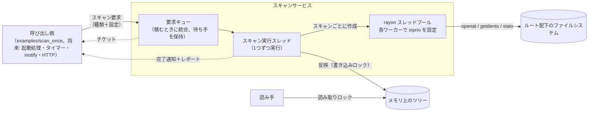
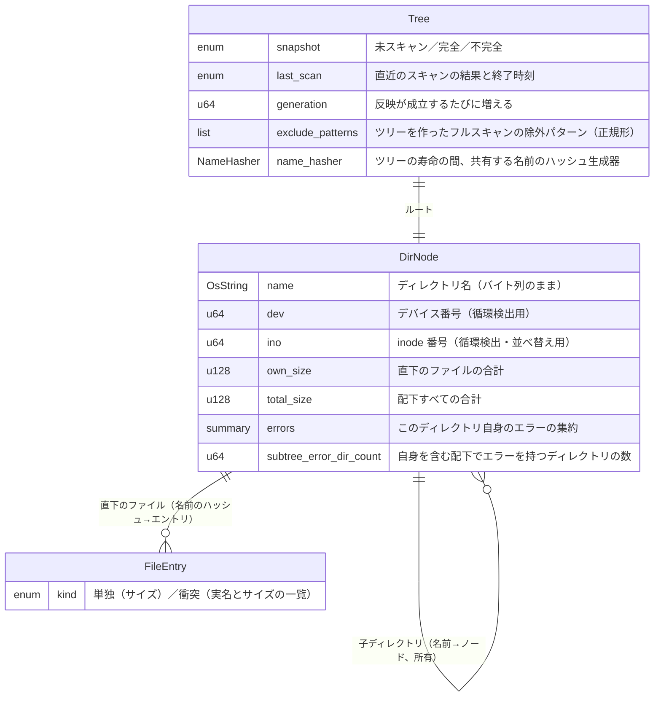
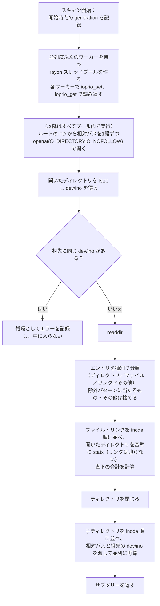

# ディレクトリスキャン 設計ドキュメント

## 1. Overview (概要)

suminoe_file_server が公開するディレクトリツリーについて、各ディレクトリ配下のファイルの合計サイズ（論理サイズ `st_size`）をメモリ上にキャッシュするための、ディレクトリスキャン機構を設計する。対象のルートディレクトリは1つで、スキャンはツリー全体を作り直す「フルスキャン」と、指定したサブツリーだけを読み直す「部分スキャン」の2種類を提供する。

スキャンの並列度・I/O 優先度・除外パターンは、スキャンを要求するたびに呼び出し側が指定する。設定はスキャンの開始時に確定し、実行中のスキャンには影響しない。走査では、#3 の計測でそれぞれ効果が確認できた並列走査と inode 順の走査を採用する（両者の組み合わせは未計測）。

サーバーへの組み込み（起動時のスキャン、定期スキャン、HTTP、inotify）はこの DD では行わず、スキャン機構を単体で動かして検証できるところまでを扱う。将来の inotify による差分更新（別 DD）がこのツリーをファイル単位で更新できるよう、ファイルごとに「名前のハッシュ＋サイズ」を保持する。

## 2. Context (背景)

- 本サーバーの目的の1つは、共有フォルダ（sugaga の `/mnt/vgmd0/srv/share`、ディレクトリ 164,717／ファイル約 1,675,021）について、ディレクトリごとの合計サイズを即座に返すことである。リクエストのたびに走査すると、キャッシュが冷えた状態では数十秒〜数分かかる（#3）。
- #3 の計測で分かっていること：
  - キャッシュが冷えた状態の走査時間は、ほぼ HDD（RAID-6、4台）の待ち時間で決まる。`orig` と GNU find はほぼ同じ時間で、コードの書き方による差はほとんどない。
  - 並列化は効く。並列度 4〜8 で orig 比約 49% 短縮し、16 では悪化してばらつきも大きくなる。
  - 子を inode 番号順に辿ると約 18% 短縮する（逐次での計測）。並列化と inode 順を組み合わせた場合は計測していない。
  - ext4 の `filetype` 機能により、readdir の時点でエントリの種別が分かる。種別を知るためだけの stat は不要。
  - キャッシュの状態や、同じ `md0` を使う他の LV の I/O によって、走査時間がバッチ間で大きく変動する（同じ `orig` で 78.7〜122.8 秒）。比較は同じバッチ内で行う必要がある。
- これまでの計測はディレクトリだけを対象にしていた。サイズを得るにはファイルごとに stat（inode の読み込み）が必要で、その分の I/O が新たに加わる。
- 同じ RAID を CI のキャッシュ（`gitlab-runner-cache`）なども使っているため、将来の定期スキャンは低い並列度と idle の I/O 優先度で、起動時のスキャンは高い並列度で動かしたい。用途によって設定を変えられる必要がある。
- 動作要件は Ubuntu 22.04（カーネル 5.15）と AlmaLinux 8（カーネル 4.18）以降とする。カーネル 4.18 で使えない機能（`openat2` など）には依存しない。
- inotify による監視（#2）はこの DD の対象外だが、そこでのイベントを反映できる受け口（部分スキャン、ファイル単位のサイズ保持、`generation`）は、この DD で用意しておく必要がある。

## 3. Scope (範囲)

### 変更対象ファイル

| ファイル | 役割・変更理由 |
|---|---|
| `Cargo.toml` | `rayon`・`globset`・`anyhow`・`log`・`env_logger`・`libc`・`rustix` を追加し、開発用に `tempfile`・`proptest` を追加する。バージョンはパッチまで固定する（既存の `actix-web = "4"` も固定する）。`[profile.release] debug = 1` を追加する |

### 新規追加ファイル

| ファイル | 役割 |
|---|---|
| `src/lib.rs` | `dir_scan` モジュールをライブラリとして公開する。`examples/` から使うには、バイナリではなくライブラリのクレートにある必要があるため |
| `src/dir_scan/mod.rs` | スキャンサービス（要求キュー、スキャン実行スレッド）と、外部に公開する操作 |
| `src/dir_scan/settings.rs` | スキャン設定（並列度・I/O 優先度・除外パターン）の型、検証、除外パターンの正規化 |
| `src/dir_scan/request.rs` | 要求の検証（パスの正規化）、統合規則、受け取り票（チケット）と完了通知。統合規則はファイルシステムに触れない純粋なロジックにする |
| `src/dir_scan/tree.rs` | メモリ上のツリー（データモデル）と、スキャン結果の反映・サイズの伝播・状態の管理 |
| `src/dir_scan/walk.rs` | 1 回のスキャンの走査処理（ディレクトリを開く処理、並列走査、inode 順、除外、循環検出、エラーの記録） |
| `src/dir_scan/report.rs` | スキャンのレポートとエラーの種類 |
| `src/dir_scan/ioprio.rs` | ワーカースレッドへの I/O 優先度の設定と読み返し（`ioprio_set`／`ioprio_get`） |
| `examples/scan_once.rs` | 動作確認・検証用のプログラム。ルートと設定を引数で受け取り、スキャンを1回実行して、レポートとディレクトリごとの合計を出力する |
| `doc/design/20261101_dir_scan_design.md` | 本 DD |

### 変更対象外

| ファイル | 理由 |
|---|---|
| `src/main.rs` | サーバーへの組み込み（起動時のスキャン、HTTP からの参照）は別 DD で扱う |

## 4. Goal (目標)

- **フルスキャンで正しいツリーを構築できる**：除外パターン `["**/.*"]` でフルスキャンした結果の、ディレクトリごとの直下のファイル合計（`own_size`）が、スキャナと同じユーザーで実行した次のコマンドの、ディレクトリ別の総和と一致する。
  ```sh
  find <root> -name '.*' -prune -o \( -type f -o -type l \) -printf '%h\t%s\n'
  ```
  - 合成ツリー（更新しない状態）では完全一致を必須とする。
  - 読めないディレクトリは、`find` の標準エラー出力に出たディレクトリと、スキャナがエラーとして記録したディレクトリが一致することを別途確認する。
  - sugaga では利用の少ない時間帯に実行する。差が出たディレクトリは両方を再実行し、一致すれば合格、再実行のたびに差が変わるなら「更新中」として除外する。
- **部分スキャンでサブツリーを差し替えられる**：ファイルを変更してから部分スキャンした結果（祖先の合計を含む）が、同じ状態でフルスキャンした結果と一致する。
- **並列度と I/O 優先度を要求ごとに指定できる**：要求のチケットで受け取ったレポートに、指定した並列度ぶんのワーカーそれぞれについて、`ioprio_get` で読み返した I/O 優先度が記録され、指定値と一致する。設定や読み返しに失敗した場合は、失敗がレポートに残る。
- **キャッシュが冷えた状態でも実用的な時間でフルスキャンできる**：`du -sb` は計算する値の意味が同じではない（ディレクトリ自身のサイズ、ハードリンク、除外の扱いが違う）が、全ファイルのメタデータを逐次に読む既存のコマンドとして基準にする。sugaga で、release ビルドの `scan_once`（並列度 4、除外 `["**/.*"]`、ディレクトリ別の出力なし、ログは info）と `du -sb` を、毎回 `sync; echo 3 | sudo tee /proc/sys/vm/drop_caches` してから、scan→du、du→scan、scan→du、du→scan の順で各 4 回実行し、`time` の実時間の中央値で `scan_once` のほうが短い。

## 5. Non-Goal (目標外)

- **サーバーへの組み込み**：起動時のスキャン、定期スキャンのタイマー、HTTP からのツリーの参照や設定の変更、設定ファイルは扱わない（別 DD）。設定の既定値も、組み込みの時点で決める。
- **inotify による監視**：監視の設定、イベントの受信・デバウンス、イベントから部分スキャンや差分更新への変換は扱わない（#2、別 DD）。
- **mtime による差分照合**：ディレクトリの mtime で構造のずれだけを検出する照合は扱わない。照合はフルスキャンで行う。
- **スナップショットの永続化**：スキャン結果のディスクへの保存は扱わない。
- **複数ルート、ハードリンクの重複除去、Linux 以外の OS**：ルートは1つ、ハードリンクは名前ごとに数える、対象は Linux（Ubuntu 22.04／AlmaLinux 8 以降）のみとする。

## 6. Solution / Technical Architecture (解決策 / 技術アーキテクチャ)

### 6.1 全体像



- スキャンサービスは、要求を受け付けるキューと、要求を1つずつ処理する専用のスキャン実行スレッドからなる。将来 actix-web（tokio）に組み込んだときに、非同期ランタイムのスレッドをブロックしないよう、ランタイムとは別のスレッドで動かす。
- スキャンは常に1つずつ実行する（直列化）。実行中に届いた要求はキューで待つ。
- 設定はスキャン要求に含めて渡し、サービス側では保持しない。スキャンは要求に含まれた設定で最初から最後まで走る。
- 要求を積むと、要求 ID と完了の受信口を持つチケットが返る。呼び出し側は、チケットで完了を待ってレポートを受け取る。

### 6.2 内部 API

| 操作 | 内容 |
|---|---|
| スキャン要求 | フルスキャン、または部分スキャン（ルートからの相対パス、`PathBuf`）を、設定と一緒に要求する。キューに積んでチケットを返し、すぐに戻る。検証に失敗した要求はその場でエラーを返す |
| 完了の待機 | チケットで、その要求の完了通知を待つ |
| ツリーの読み取り | ツリーの状態と、指定したディレクトリの合計サイズ・子ディレクトリごとの合計サイズを、それぞれ「その合計が完全か」（配下にエラーを持つディレクトリがないか）と一緒に読む。読み取りロックを取るので、反映の瞬間だけ待つことがある |
| 直近のレポートの取得 | フルスキャンと部分スキャンそれぞれについて、直近のレポートを読む（監視や表示用。自分の要求の結果はチケットで受け取る） |
| 停止 | 次の順で止める：(1) 新しい要求の受け付けを止める、(2) 実行中のスキャンがあれば、その1件だけを完了させる、(3) キューに残っている未実行の要求をすべて取り出し、待ち手全員に「停止」を通知する、(4) スキャン実行スレッドを終了する、(5) 呼び出し元に戻る。キューに残っている要求は実行しない |

ID は2種類を区別する。`request_id` は要求（API の呼び出し）ごと、`execution_id` は実際に走ったスキャンごとに振る。統合された要求の待ち手は全員、同じ `execution_id` のレポートを受け取る。

完了通知は、要求ごとに次の項目を返す。統合と格上げは同時に起こりうるので、要求の行き先と、実行の種類を別の項目にする。

| 項目 | 内容 |
|---|---|
| `request_id` | その要求の ID |
| 行き先 | 実行（その要求として実行された）／統合（別の要求に統合されて実行された。統合先の `request_id` を含む）／失敗（実行したがツリーに反映されなかった。ルートが開けない、部分スキャンの対象が `EACCES` で開けない、走査中のパニックなど）／停止（実行される前にサービスが停止した） |
| `execution_id` | 実行された場合、そのスキャンの ID |
| 要求された種類 | フル、または部分（要求されたパス） |
| 実行された種類 | 実際に走ったスキャンの種類と対象。要求された種類が部分で、実行された種類がフルなら格上げされたことが分かる |
| レポート | 実行された場合、そのスキャンのレポート |

スキャンのレポートには次を含める。

- `execution_id` と、この実行に含まれる `request_id` の一覧。種類、要求されたパス（`requested_path`）と実際に走査したパス（`effective_path`）、親に遡ってやり直した場合はその経緯。
- 要求された設定（除外パターンは正規化後のもの）。
- 開始・終了時刻（システム時刻）と、所要時間（単調増加する時計で測る）。所要時間は全体のほか、走査、書き込みロックを取るまでの待ち、反映、古いツリーの解放に分けて記録する。
- ワーカーごとの I/O 優先度の結果（ワーカー番号、OS のスレッド ID、要求値、設定の成否、読み返した値）。
- ディレクトリ数・ファイル数、ルートの合計サイズ、ハッシュ衝突の件数。
- エラーの件数（6.5 のエラーの種類別、OS のエラー番号別）と、ログを抑制した件数。
- `generation` の、スキャン開始時・反映前・反映後の値。

レポートは `log::info!` に要約（ワーカーごとの I/O 優先度は失敗したものだけ）を出す。

設定は次の値をすべて呼び出し側が指定する。既定値は持たない。

| 設定 | 値 |
|---|---|
| 並列度 | 1〜64 |
| I/O 優先度 | `idle`、または `best-effort` のレベル 0〜7。`realtime` は `CAP_SYS_ADMIN` が必要で、他の I/O を止めうるので受け付けない |
| 除外パターン | ルートからの相対パスに対する glob の一覧（UTF-8 の文字列）。パスの区切りをまたがない照合（`literal_separator`）とし、どの階層の名前にも当てたい場合は `**/.*` のように書く。ディレクトリが当たった場合は、そのサブツリーごと除外する。照合は、非 UTF-8 の名前も含めてパスのバイト列に対して行い、パスの区切りは `/` の1バイトとする。非 UTF-8 の名前をパターンに直接書くことはできず、`*` や `**` などのワイルドカードでのみ対象にできる。`?` や文字クラスが非 UTF-8 のバイトにどう当たるかは globset の挙動に従い、実装の初期にテストで確かめる。受け付けた時点で、パターンを並べ替えて重複を除いた正規形にする |

- I/O 優先度の効き方は、HDD 本体のキュー（`/sys/block/sdX/queue/scheduler`）の I/O スケジューラに依存する。dm や md のデバイス自身はスケジューラを持たない。BFQ では `best-effort` のレベルも効くが、mq-deadline はクラス（idle／best-effort）しか区別せず、idle の要求も一定時間待つと処理される（後者は未確認）。

### 6.3 要求の検証と統合

- 部分スキャンのパスは、積む前に検証する。絶対パス、`..` を含むパス、空のパスは拒否する（ルート全体を読み直したい場合はフルスキャンを要求する）。
- 統合は、キューに積むときに行う。キューの各要素は、実行するスキャンの内容と、待ち手（元の要求のチケット）の一覧を持つ。
  - 統合するのは、設定（並列度・I/O 優先度・正規化した除外パターン）が完全に同じ要求同士だけとする。設定が違う要求は統合しない。
  - フルスキャンは、同じ設定の部分スキャンをすべて含む。部分スキャンは、同じ設定で配下（または同じ）のパスの部分スキャンを含む。
  - 統合した要素は、統合された要素のうち**一番古いもののキューの位置**を引き継ぐ。待ち時間が延びないようにするため。
  - 統合されなかった要素は、積まれた順に実行する。
  - 実行中のスキャンには、何も統合しない。
- 例（X・Y は設定）：

  | 積まれた順 | キュー |
  |---|---|
  | A: X, 部分 `a/b` | A |
  | B: Y, 部分 `z` | A → B |
  | C: X, 部分 `a`（A を含む） | C（A の位置、待ち手 A・C）→ B |
  | D: X, フル（C を含む） | D（C の位置、待ち手 A・C・D）→ B |

- 実行の直前に、次の場合は部分スキャンをフルスキャンに格上げする（設定はその要求のもの）。並列度と I/O 優先度はツリーの内容に影響しないので、比べるのは除外パターンだけとする。
  - 公開しているツリーがまだない（未スキャン）。
  - 要求の除外パターンが、現在のツリーを作ったフルスキャンの除外パターンと違う。違うパターンで作られた部分がツリー内に混ざらないようにするため。

### 6.4 データモデル



- **ツリーの構造**：子ディレクトリは、親が「名前 → ノード」の表で直接所有する。添字で参照する配列（アリーナ）や親への参照は持たない。
  - 部分スキャンの反映は、その位置の部分木を入れ替えるだけで済む（6.6）。
  - 祖先へのサイズの伝播は、ルートから対象のパスを名前で辿って行う。将来の inotify のイベントもパスで届くので、親への参照は不要。
  - 外した部分木は丸ごとロックの外へ移して解放できる。添字の付け直しや空き領域の管理も要らない。
- **名前**：ディレクトリ名と要求のパスは、Linux の非 UTF-8 の名前もそのまま持てる `OsString`／`PathBuf` で扱う。名前の照合とハッシュの計算は、表示用の文字列ではなく元のバイト列で行う。ログやレポートに出すときだけエスケープする。
- **ファイル**は、ディレクトリごとに「名前のハッシュ → エントリ」の表で持つ。将来の inotify によるファイル単位の更新では、イベントに含まれる名前のハッシュで古いサイズを引き、差分を祖先に伝えられる。削除やツリー内での移動は I/O なしで反映でき、書き込みや作成も対象ファイル1個の stat で済む。ファイル名の一覧は返せないが、目的（サイズのキャッシュ）には不要。
- **ハッシュの衝突**：1 回の readdir の結果に同じ名前は2つ出ないので、同じディレクトリ内でハッシュが重なれば確実に衝突である。そのハッシュのエントリだけを「衝突」にし、実名とサイズの一覧で持つ。通常のエントリはサイズだけなので、メモリはほぼ増えない。衝突中のファイルの削除やサイズ変更も、実名で引けば正しく反映できる。件数はレポートに記録する。
- **ハッシュ生成器**：ツリーが存在する間は同じハッシュ生成器を使い、同じ名前のバイト列からは常に同じ値を得る。プロセスの再起動をまたいで同じ値である必要はない。共有フォルダの利用者がファイル名を自由に付けられるので、衝突を狙った名前を作られないよう、シードはランダムにする（std の `RandomState`）。
  - 名前のハッシュは、`RandomState` を持つ具体的な型（`NameHasher`）1つで計算する。型パラメータにはせず、ツリーやサービスの型に広げない。テストのときだけ、衝突するハッシュを返す `NameHasher` を作れるようにする（`#[cfg(test)]`）。
  - フルスキャンは新しい `NameHasher` を作り、新しいツリーと一緒に置き換える。部分スキャンは、開始時に読み取りロックの中でツリーの `NameHasher` を複製し、走査から反映まで同じものを使う。
  - 子ディレクトリの表も外部から付けられる名前をキーにするので、std の `HashMap` の既定（ランダムなシード）を使う。
- **シンボリックリンク**は辿らず、リンク自身の `lstat` のサイズを1ファイルとして数える。リンク先が存在しなくても影響しない。
- **FIFO・ソケット・デバイスファイル**は数えない（Goal のコマンドの `-type f -o -type l` と揃える）。
- **ハードリンク**は名前ごとに数える。重複は除かない。
- **マウントポイント**：ルートの下に別のファイルシステムがマウントされていれば、その中も辿り、合計に含める。
- 合計サイズはディレクトリ自身のサイズ（ディレクトリエントリのブロック）を含めない。
- **サイズの型**：ファイルのサイズは `u64`（`st_size`）で持ち、ディレクトリの合計（`own_size`・`total_size`）は `u128` で持つ。`u64` の値を足して `u128` が溢れるには 2⁶⁴ 個のファイルが必要なので、溢れは事実上起きず、「サイズ不明」という状態を持たずに済む。`u64` で持つと、巨大なスパースファイル（XFS では 1 個 8EiB まで作れる）を数個置かれるだけで溢れうるため、`u128` にする。加算・減算は `checked_add`／`checked_sub` で行い、失敗はツリーの内部不整合として扱う（6.6）。
- **エラーの集約**：ディレクトリごとに、開けなかった・readdir が途中で失敗した場合のエラー番号、stat のエラーの種類別の件数（`EACCES`・`EIO`・その他）、循環の検出を持つ。個々のエラーの詳細はノードに残さず、ログとレポートに出す。readdir と stat の間に消えたファイル（`ENOENT`）は正常な競合として、ノードのエラーにはしない（レポートの件数には数える）。
- **ツリーの状態**は2つの軸で持つ。
  - 公開しているツリー：未スキャン／完全（エラーを持つディレクトリが無い）／不完全（ある）。各ノードが「自身を含む配下でエラーを持つディレクトリの数」を持ち、ツリー全体の完全性はルートの値で判断する。ディレクトリごとの合計が完全かどうかも、そのノードの値で返せる。
  - 直近のスキャン：成功／エラーありで成功／失敗と、その終了時刻。直近のスキャンが失敗しても、前のツリーは公開し続ける。
- **メモリの見積もり**：ファイル1件あたり、表の要素（ハッシュ 8 バイト＋サイズ 8 バイト）に、ハッシュ表の空き（使用率 50〜90%）を加えて 20〜35 バイト程度。ディレクトリ1件あたり、名前・各フィールド・子ディレクトリとファイルの表の固定部分と、親の表の要素で 270〜370 バイト程度（`u128` の合計 2 つを含む）。sugaga の規模では合わせて 80〜120MB 程度と見込む。フルスキャンの反映が終わるまでは新旧のツリーが同時に存在するので、ピークはその約2倍になる。

### 6.5 1 回のスキャンの走査



- **プール内での実行**：ルートの readdir も含め、ファイルシステムへのアクセスはすべてスレッドプールのワーカーの中で行う。スキャン実行スレッド自身はファイルシステムに触れない（優先度を設定していないスレッドからの I/O を出さないため）。
- **ディレクトリの開き方**：
  - ルートは、スレッドプールを作った後、`pool.install` の中（ワーカー上）で開く。その FD をスキャンの走査処理で共有し、走査が終わったら閉じる。スキャン実行スレッドは、`pool.install` の呼び出しと結果の反映だけを行い、ルートの open を含むファイルシステムの操作を直接行わない。
  - 各走査タスクは、ルートからの相対パスと、祖先の dev/ino の一覧を持つ。
  - ディレクトリは、ルートの FD から相対パスの要素を1段ずつ `openat(O_DIRECTORY|O_NOFOLLOW)` で開き、途中の段の FD はすぐ閉じる。`O_NOFOLLOW` が全段に効くので、パスの途中にシンボリックリンクが挟まっていても辿らない。`openat2` の `RESOLVE_NO_SYMLINKS` はカーネル 5.6 以上が必要で、AlmaLinux 8（4.18）では使えないため採らない。
  - 同時に開いている FD は、ワーカー数程度（各ワーカーが今読んでいるディレクトリと、開く途中の1段）に収まる。
  - パスの解決はディレクトリごとに段数ぶんのシステムコールになるが、直前に辿った祖先なので dentry キャッシュに乗っており、ディスク I/O は増えない。
  - readdir してから子ディレクトリを開くまでの間に、名前がリネームされたりシンボリックリンクに置き換えられたりすると、開けないか別の実体を開く。これは「走査中の変更」として許容する。開けなかった場合の扱いは、エラー番号で分ける（下のエラーの扱いの表を参照）。
- **readdir と stat**：FD を基準にしたシステムコール（`getdents64`・`statx`・`fstat`）を使うため、`rustix` を使う。
  - 種別は readdir の結果（d_type）から判定し、種別のためだけの stat はしない。種別が返らない（`DT_UNKNOWN`）場合だけ、そのエントリを stat する。
  - ファイルの stat は、開いているディレクトリの FD を基準に名前で行い（`AT_SYMLINK_NOFOLLOW`）、ルートからのパスを解決しない。
- **dev/ino の取得**：開いたディレクトリを fstat して得る。開いた時点で inode は読み込み済みなので、ディスク I/O は増えない。マウントポイントの中も辿るので、bind マウントでツリーが循環している場合に無限に辿らないよう、祖先と比べる。
- **順序**：ファイルと子ディレクトリは、どちらも inode 番号順に処理する。子ディレクトリは rayon の並列イテレータに渡すため、作業の奪い合いで実際の順序は一部崩れる。並列と inode 順を組み合わせた効果は未計測（8 を参照）。
- **エラーの種類**：`OpenDirectory`、`ReadDirectory`、`StatFile`（`ENOENT` とそれ以外を分けて数える）、`StatUnknownEntry`、`ChangedDuringScan`、`CycleDetected`、`IoprioSet`、`IoprioGet`、`WalkPanic` とする。OS のエラー番号は別に数える。
- **エラーの扱い**（test/dir_scan/1 にあった「エントリ1つの失敗でディレクトリごと消える」問題を避ける）。どのエラーも処理は止めない。

  | 状況 | 扱い |
  |---|---|
  | ディレクトリが `EACCES`・`EPERM`・`EIO`・その他のエラーで開けない | readdir で得た名前でエラーノードとしてツリーに残し、合計 0 とする（不完全として扱われる） |
  | readdir が途中で失敗した | 読めた分は残し、ディレクトリにエラーを付ける |
  | ファイルの stat が `ENOENT`（readdir と stat の間に消えた） | 数えずに進む。ノードのエラーにはしない |
  | ファイルの stat がその他のエラー（`EACCES`、`EIO` など） | そのファイルは合計に含めず、ディレクトリにエラーを付ける |
  | ディレクトリが `ENOENT`・`ENOTDIR`・`ELOOP` で開けない（消えた、ファイルやシンボリックリンクに置き換えられた） | 走査中の変更（`ChangedDuringScan`）として数え、ツリーには載せない |
  | 循環を検出した | エラーを付けてツリーに残し、中には入らない |

- **ログの量**：エラーは、1 回のスキャンにつき種類ごとに先頭 100 件だけ `log::warn!` に出し、それ以降は抑制して件数をレポートに残す。`debug` レベルでは全件出す。
- **走査中のパニック**：rayon のワーカーで起きたパニックは、スレッドプールの `install` の呼び出し元に伝わる。スキャン実行スレッドで `install` の周りを `catch_unwind` で囲み、そのスキャンを失敗としてレポートに記録する。ツリーには反映しない。スキャン実行スレッドは次の要求の処理を続ける。ワーカーの開始時の処理（I/O 優先度の設定）は、結果を記録するだけでパニックしないように書く。
- **走査中の変更**：スキャン中にファイルが変わった場合、そのスキャン結果はある時点の正確なスナップショットにはならない。この不整合は、次のスキャン（将来は inotify のイベント）で解消する前提とする。

### 6.6 ツリーへの反映

- スキャンは、新しいツリー（フル）またはサブツリー（部分）を、既存のツリーとは別に組み立てる。組み立て中は既存のツリーに触らないので、読み手は待たされない。メモリの確保が必要な処理（表の構築、エラーの集計）は、すべてロックを取る前に済ませる。
- 書き込みロックの中では、部分木の入れ替え、経路上の合計の更新、状態と `generation` の更新だけを行う。外した部分木やツリーは、ロックを手放してから解放する。
- **フルスキャン**：
  - ルートのノードを入れ替え、除外パターンと状態を更新する。
  - ルート自体が開けない場合は、前のツリーを残し、直近のスキャンを「失敗」にする。前のツリーが無ければ、公開しているツリーは未スキャンのままにする。
- **部分スキャン**：
  - 指定されたパスは「変更があった可能性のあるパス」として扱い、実際に走査する対象は、そのパスをツリーの中で名前で辿って、辿れた一番深いディレクトリとする。

    | 要求のパス | ツリーにあるもの | 実際に走査する対象 |
    |---|---|---|
    | `a/b` | `a/b` がディレクトリ | `a/b` |
    | `a/new/x` | `a` まで | `a` |
    | `a/b/file.txt` | `a/b` がディレクトリ | `a/b` |
    | `a/.cache/x`（除外対象） | `a` まで（`.cache` は除外されて載っていない） | `a` |
    | `a/link/x`（`link` はシンボリックリンク） | `a` まで（リンクはディレクトリとして載らない） | `a` |

  - 対象ディレクトリ自体を開けなかった場合は、エラー番号で分ける。
    - `ENOENT`・`ENOTDIR`・`ELOOP`（消えた、ディレクトリでなくなった）：親を対象にしてやり直し、その経緯をレポートに残す。ルートまで遡った場合は、フルスキャンの規則に従う。
    - `EACCES`・`EIO`・その他：既存の部分木を残し、その部分スキャンを失敗にする。合計 0 の部分木に置き換えると、キャッシュの値が急に小さくなるため。親に遡っても同じエラーになる可能性が高いので、遡らない。
  - 読み直した結果で部分木を入れ替え、ルートから対象までの経路上の祖先の `total_size` と `subtree_error_dir_count` を、古い部分木の値を引いて新しい部分木の値を足すことで更新する。
  - 更新は二段階で行う。書き込みロックの中で、まず経路を辿って祖先ごとの新しい値をすべて計算し（`checked_add`／`checked_sub`）、全部が成功したことを確かめてから書き込む。`checked_sub` の失敗は、祖先の合計が子の合計より小さいことを意味し、ツリーの内部不整合である。この場合は反映処理でのパニックと同じく、回復不能としてプロセスを終了する。
- **`generation`**：
  - 初期値は 0（未スキャン）とする。
  - ツリーへの反映が成立するたびに、内容の変化の有無やエラーの有無を問わず 1 増やす。反映されなかったスキャン（失敗）では増やさない。
  - レポートには、スキャン開始時・反映前・反映後の値を記録する。将来の inotify の DD で、「スキャン開始後に届いたイベント」を再適用するときの基準に使えるようにするため。
  - `checked_add` で増やし、溢れた場合は回復不能な内部状態としてプロセスを終了する（64 ビットなので、実際には起きない）。将来、スキャン開始時の値との大小比較に使えるよう、一回りはさせない。
- **反映処理でのパニック**：反映処理（ロックを持っている間）は、メモリ確保をほぼ行わない小さな処理に限る。それでもパニックした場合はツリーの整合性を保証できないので、`catch_unwind` で捕まえて `std::process::abort()` でプロセスを終了する。

### 6.7 I/O 優先度の適用

- スキャンごとに作るスレッドプールの、各ワーカースレッドの開始時に `ioprio_set` を呼び、そのスレッドの I/O 優先度を設定する。プロセス全体の優先度は変えないので、他のスレッドには影響しない。
- 設定の直後に `ioprio_get` で読み返す。ワーカー番号ごとの結果を共有の記録に書き込み、レポートに載せる。区別するのは次の場合：設定に失敗した、設定は成功したが読み返しに失敗した、読み返した値が要求値と違う。
- 失敗したワーカーは、カーネルの既定の優先度のまま続ける。スキャン自体は止めない。スレッドプール自体を作れなかった場合は、スキャンを失敗にする。
- `libc` に `ioprio_set`／`ioprio_get` のラッパーはないので、システムコールを直接呼ぶ。
- スレッドプールはスキャンが終われば破棄する。スキャンの時間（数十秒〜）に比べて、スレッドを作るコストは無視できる。

### 6.8 検証用プログラム

- `examples/scan_once.rs` は、ルート・スキャンの種類・設定を引数で受け取り、スキャンサービスを立ち上げて要求を積み、チケットで完了を待ってレポートを出力し、サービスを停止して終了する。
- オプションで、ディレクトリごとの `own_size` を `find -printf '%h\t%s\n'` と突き合わせやすい形式（パスと合計のタブ区切り）で出力する。Goal 1 と Goal 4 の検証、および I/O 優先度の効果の確認（8 を参照）に使う。
- 部分スキャンの検証用に、フルスキャンの後に指定パスの部分スキャンを続けて実行するモードを持つ。

## 7. Alternative Solution (代替案)

### 代替案1: 並列化の方式

1. **スキャンごとに rayon のスレッドプールを作る（採用）**
   - **Pros**：並列度を要求ごとに変えられる。ワーカーごとに I/O 優先度を設定できる。#3 の計測で使った方式と同じ。
   - **Cons**：作業の奪い合いで inode 順が一部崩れる。
2. **ツリーの階層ごとに全ディレクトリを inode 順に並べ、固定数のワーカーで処理する**
   - **Pros**：inode 順の局所性を保ったまま、同時に複数の要求を出せる。
   - **Cons**：実装が複雑になる。効果は未計測で、#3 の考察で「やらない」と判断した。
3. **tokio の `spawn_blocking` で走査する**
   - **Pros**：既存の非同期ランタイムに乗れる。
   - **Cons**：ブロッキング用のスレッドプールは他の処理と共有されるので、スレッド単位の I/O 優先度を設定できない。並列度も制御しにくい。
- **判断**：1 を採用する。2 は、起動時の時間が問題になったときに改めて検討する。

### 代替案2: 子ディレクトリの開き方

1. **ルートの FD から、相対パスを1段ずつ `openat(O_NOFOLLOW)` で開く（採用）**
   - **Pros**：同時に開く FD がワーカー数程度に収まる。全段でシンボリックリンクを辿らないことを保証できる。カーネル 4.18 でも使える。
   - **Cons**：ディレクトリごとに段数ぶんのシステムコールがかかる（キャッシュに乗るので CPU 時間のみ）。readdir から開くまでの間のリネームで取り違えうる。
2. **`openat2` の `RESOLVE_NO_SYMLINKS` で、ルートの FD から一度に開く**
   - **Pros**：1 回のシステムコールで、全段でリンクを辿らないことを保証できる。
   - **Cons**：カーネル 5.6 以上が必要で、動作要件の AlmaLinux 8（4.18）では使えない。
3. **readdir の時点で子ディレクトリを親の FD 基準で開き、FD を持っておく**
   - **Pros**：名前の解決が readdir と一致し、取り違えが起きにくい。
   - **Cons**：子が多いディレクトリでは FD が子の数まで増え、FD の上限（既定 1024）を超える。
4. **親の FD を、全部の子を開き終えるまで持ち続ける**
   - **Pros**：子を親の FD 基準で開ける。
   - **Cons**：FD が「ワーカー数 × 深さ」程度まで増え、並列度 64 では FD の上限を超えうる。
- **判断**：1 を採用する。2 は、動作要件からカーネル 5.6 未満が外れたときに検討する。

### 代替案3: 設定の渡し方

1. **要求ごとに全設定を指定する（採用）**
   - **Pros**：サーバーに組み込む前の段階で、既定値という未決定の概念を持ち込まずに済む。スキャンごとの設定が要求から一意に決まり、テストしやすい。
   - **Cons**：呼び出し側が毎回すべての値を用意する必要がある。
2. **サービスが既定の設定を保持し、要求で上書きする**
   - **Pros**：呼び出し側が楽になる。
   - **Cons**：既定値をどう決めるかは組み込み方（起動時・定期・inotify）に依存し、現時点では決められない。上書きの有無で統合規則も複雑になる。
- **判断**：1 を採用する。既定値は、サーバーに組み込む DD で必要になれば呼び出し側に持たせる。

### 代替案4: ファイルごとに保持する情報

1. **名前のハッシュ＋サイズ、衝突したハッシュだけ実名を持つ（採用）**
   - **Pros**：将来の inotify のイベントを I/O 最小で反映できる。衝突しても差分更新が正しくできる。通常時のメモリはハッシュ＋サイズのまま。
   - **Cons**：ファイル名の一覧は返せない。衝突時の分岐が実装に増える。
2. **名前のハッシュ＋サイズ、衝突したらサイズを足して1エントリにする**
   - **Pros**：構造が最も単純。
   - **Cons**：衝突したファイルの片方が削除・変更されたときに、どちらの値を引けばよいか分からず、ファイル単位で持つ目的（差分更新）を満たせない。
3. **全ファイルの実名＋サイズ**
   - **Pros**：ファイル一覧も返せる。衝突の心配がない。
   - **Cons**：ファイル名の分（sugaga で 40〜100MB 程度）メモリが増える。現時点の目的には不要。
4. **ディレクトリごとの合計だけを持つ**
   - **Pros**：メモリが最小。
   - **Cons**：ファイルの変更を差分で反映できず、イベントのたびに兄弟ファイルをすべて stat し直すことになる。
- **判断**：1 を採用する。ファイル名が必要になったら、3 への切り替えを検討する。

### 代替案5: ツリーの持ち方

1. **親が子を所有する木構造（採用）**
   - **Pros**：部分木の入れ替えが一定時間で済み、外した部分木をそのままロックの外で解放できる。添字の付け直しや空き領域の管理が要らない。
   - **Cons**：親への参照を持たないので、祖先の更新はルートからパスを辿って行う（深さぶん）。
2. **添字で参照する配列（アリーナ）と親への添字**
   - **Pros**：任意のノードから親を直接辿れる。
   - **Cons**：部分スキャンの結果を移すときに、部分木の全ノードの添字を付け直す必要があり、書き込みロックの時間が部分木の大きさに比例する。空き領域の再利用と断片化の管理も必要になる。
- **判断**：1 を採用する。

### 代替案6: 読み手への公開方法

1. **書き込みロック（`std::sync::RwLock`）の中で差し替える（採用）**
   - **Pros**：部分スキャンでも、差し替える部分だけを変更できる。組み立てと解放はロックの外で行うので、書き込みロックを持つのは短時間。
   - **Cons**：反映の瞬間だけ読み手が待つ。
2. **ツリー全体を複製し、ポインタを差し替える（`Arc` の入れ替え）**
   - **Pros**：読み手は一切待たない。
   - **Cons**：部分スキャンのたびに、ツリー全体を複製することになる。
3. **永続データ構造（構造共有のある不変ツリー）**
   - **Pros**：複製のコストが小さく、読み手も待たない。
   - **Cons**：実装と依存が複雑になり、「愚直で平易なコード」の方針に反する。
- **判断**：1 を採用する。

### 代替案7: I/O を絞る手段

1. **ワーカースレッドごとの `ioprio_set`（採用）**
   - **Pros**：スキャンのスレッドだけを対象にできる。`idle`／`best-effort` の範囲なら権限が要らない。
   - **Cons**：HDD 本体のキューの I/O スケジューラが優先度を扱う場合にしか効かない。dm-thin と md を経由すると、優先度が伝わらない I/O がありうる（8 を参照）。
2. **プロセス全体の `ionice`**
   - **Pros**：設定が簡単。
   - **Cons**：将来組み込んだときに、HTTP の処理の I/O も一緒に下がる。
3. **cgroup の I/O 制御（`io.max`、`io.weight`）**
   - **Pros**：帯域や IOPS の上限で、確実に絞れる可能性がある。
   - **Cons**：systemd での委譲など、運用側の準備が必要。スレッド単位では効かない。
- **判断**：1 を採用する。sugaga で効かないことが分かったら、3 を検討する。

## 8. Concerns (懸念事項)

- **I/O 優先度が sugaga で効かない可能性**：sugaga の構成は ext4 → LVM thin → md RAID-6 → HDD 4 台。優先度が効くには、HDD 本体のキューの I/O スケジューラが優先度を扱い、かつ I/O がスキャンのワーカースレッドの文脈で発行される必要がある。dm の単純な付け替えや、raid456 のチャンク内に収まる読み込みは呼び出し元の文脈で発行されるので引き継がれるが、カーネルのワーカースレッド（kworker や raid5d）に回される I/O は、そのスレッドの優先度になる（いずれも未確認）。
  - 緩和策：実装後に、HDD の I/O スケジューラを確認したうえで、別プロセスで連続読み込みを流しながら、`scan_once` を `idle` と `best-effort` で実行し、スキャン時間と相手の読み込み速度を比べる。効かなければ、代替案7 の 3（cgroup）を検討する。
- **並列と inode 順の組み合わせの効果が未計測**：#3 で計測したのは、並列（inode 順なし）と、逐次での inode 順だけ。組み合わせても効果が足し算になる保証はなく、作業の奪い合いで inode 順の効果が薄れる可能性がある。Goal 4 の計測で、組み合わせた状態の時間を確認する。
- **ファイルの stat を含めたフルスキャンの時間が未計測**：約 167 万ファイルの inode を読むコストが加わる。また、ディレクトリを開くたびに相対パスを1段ずつ解決するコスト（CPU のみ）も、#3 の計測には含まれていない。
  - 緩和策：Goal 4 の計測で、同じ条件の `du -sb` と比べて分かる。極端に長ければ、スナップショットの永続化（別 DD）を優先する。
- **メモリ使用量**：6.4 の見積もりで 80〜120MB 程度、フルスキャンの反映中はその約2倍。木構造ではディレクトリごとに表や名前を個別に確保するので、小さいディレクトリが多いとアロケータの管理領域の分だけ見積もりより増えうる。sugaga のメモリで許容できるかを、実装後に次の RSS（プロセスが実際に使っている物理メモリ量）を測って確認する：走査完了後、フルスキャンの反映直前（ピーク）、旧ツリーの解放後。あわせて、ディレクトリ1件・ファイル1件あたりのおおよその増分を求める。
- **書き込みロックの時間**：反映処理は小さく限定するが、経路上の更新と状態の更新にかかる時間は実測していない。レポートの「反映」「ロック待ち」の所要時間で確認する。
- **将来の inotify でのハッシュ衝突**：スキャン時の衝突は実名で持つので正しく扱える。一方、inotify で新規作成されたファイルのハッシュが、実名を持たない既存のエントリと重なった場合、それが衝突なのか、取りこぼした削除の後の同じファイルの作り直しなのかは区別できない。inotify の DD への申し送りとする（例：その場でディレクトリを部分スキャンする）。
- **スキャン中の変更**：スキャン中に変更されたファイルの反映は、タイミング次第で漏れたり古くなったりする。将来の inotify の DD で、`generation` を基準にスキャン開始後のイベントを再適用して解消する。
- **ハードリンクと将来の inotify**：名前ごとに数えるので、別のディレクトリにある別名から書き込まれたファイルは、このディレクトリへのイベントが来ずにサイズが古くなる。フルスキャンでの作り直しで解消する前提として、inotify の DD に引き継ぐ。
- **マウントポイントと循環**：マウント先も辿るので、意図せず大きなファイルシステムがルートの下にマウントされると、スキャン時間と合計が大きく変わる。bind マウントによる循環は 6.5 の検出で止める。
- **将来の要求の殺到**：統合は同じ設定の要求同士にしか効かないので、将来 inotify から設定の異なる要求が大量に来ると、キューが伸び続ける可能性がある。キューの上限は inotify の DD で決める。
- **深いツリーでのスタック**：rayon の並列イテレータの入れ子で、深いツリーではワーカースレッドのスタックが深くなる。必要なら、スレッドプールのスタックサイズを指定する。
- **読めないディレクトリ**：スキャナを動かすユーザーの権限で読めないディレクトリ（sugaga では `disk-images/Windows10/1511/...` 配下の 4 つ）は、合計に含まれない。エラーとしてツリーに残り、ツリーは「不完全」になるので、読み手から分かる。
- **CI が未整備**：`cargo fmt --check` と `cargo clippy --tests --examples -- -Dclippy::all` をローカルで通すことにする。CI の整備は別途行う。

## 10. Safety and Reliability (安全性と信頼性)

- **テストの実施**：
  - ファイルシステムに触れない純粋なロジックは、I/O なしのユニットテストで確認する。
    - パスの検証、設定値の検証、除外パターンの正規化
    - 要求の統合規則。例に加えて `proptest` で次の性質を確かめる：統合後も元の要求の対象範囲を失わない、設定の違う要求は統合されない、統合した要素は一番古い位置を引き継ぐ、すべての元の要求の待ち手が完了通知を受け取る
    - サイズの伝播と、内部不整合（`checked_sub` の失敗）の検出
    - 状態と `generation` の遷移
    - ハッシュ衝突：衝突させるハッシュ生成器を差し込み、複数の名前が同じ値になっても `own_size`・`total_size` が正しいこと、衝突の件数がレポートに出ること、衝突中のファイルの削除・サイズ変更を正しく反映できること
  - 走査と反映は、テストごとに一時ディレクトリにツリーを作り、次の点を確認する。
    - フルスキャンの合計値
    - 部分スキャンの差し替えと、祖先へのサイズの伝播（6.6 の表の各ケース、ディレクトリがファイルに変わった場合、対象が消えた場合を含む）
    - 除外パターン（サブツリーごと除外されること、ルート直下の `.` で始まる名前にも `**/.*` が当たること）
    - シンボリックリンクを辿らないこと（パスの途中のリンクを含む）、FIFO を数えないこと
    - 非 UTF-8 の名前のファイル・ディレクトリを扱えること
    - 読めないディレクトリをエラーとして残すこと（root で実行すると権限が効かないので、root のときはこのテストを飛ばす）。部分スキャンの対象が読めない場合に、既存の部分木が残り、その部分スキャンが失敗になること
    - 子ディレクトリを開けないときの、エラー番号ごとの扱い（`ENOENT`・`ENOTDIR`・`ELOOP` は載せない、`EACCES` などはエラーノードとして残す）
    - チケットで完了を待ち、正しい結果とレポートを受け取れること（統合と格上げが同時に起きた場合を含む）。停止したときに、未実行の要求すべてに「停止」が届くこと
  - E2E テストでは、`examples/scan_once` を合成ツリー（#3 で使ったもの）と sugaga の実データに対して実行し、Goal 1 の方法で `find` の結果と突き合わせる。
- **テストカバレッジの計測**：`cargo llvm-cov` で計測し、80% 以上にする。
- **静的型付け言語の採用**：Rust で実装する。設定値は範囲を検証する型で受け取り、範囲外の値はスキャン要求の時点で拒否する。名前とパスは `OsString`／`PathBuf` の型で扱い、UTF-8 への変換は表示のときだけ行う。

## 11. References (参考資料)

- [#2 ファイルシステムの監視機構に使えそうなものを調べる](https://github.com/yumetodo/suminoe_file_server/issues/2)：inotify による監視の検討
- [#3 directory scanの性能を調べる](https://github.com/yumetodo/suminoe_file_server/issues/3)：走査の計測結果と考察（Hyper-V VM と sugaga）
- [`test/dir_scan/2` ブランチ](https://github.com/yumetodo/suminoe_file_server/tree/test/dir_scan/2)：計測に使った走査方式の比較ツール
- [ioprio_set(2)](https://man7.org/linux/man-pages/man2/ioprio_set.2.html)：スレッド単位の I/O 優先度
- [openat(2)](https://man7.org/linux/man-pages/man2/openat.2.html)：`O_NOFOLLOW`・`O_DIRECTORY` と、ディレクトリの FD を基準にした open
- [openat2(2)](https://man7.org/linux/man-pages/man2/openat2.2.html)：`RESOLVE_NO_SYMLINKS`（カーネル 5.6 以上。採らなかった代替案）
- [statx(2)](https://man7.org/linux/man-pages/man2/statx.2.html)：FD を基準にした stat
- [rustix](https://docs.rs/rustix/latest/rustix/)：FD を基準にしたシステムコールのラッパー
- [rayon::ThreadPoolBuilder](https://docs.rs/rayon/latest/rayon/struct.ThreadPoolBuilder.html)：スレッドプールの作成と、ワーカー開始時の処理（`start_handler`）
- [globset](https://docs.rs/globset/latest/globset/)：除外パターンの照合
- [proptest](https://docs.rs/proptest/latest/proptest/)：統合規則のプロパティテスト
- [inotify(7)](https://man7.org/linux/man-pages/man7/inotify.7.html)：将来の差分更新で使うイベントの種類
- [ext4 のマウントオプション（`inode_readahead_blks`）](https://docs.kernel.org/admin-guide/ext4.html)：inode 順の走査が効く理由の推測の根拠

## 12. Work Log  (作業ログ)

### 2026-11-01

- スキャンの目的が「ディレクトリ配下のファイルサイズのキャッシュ」であることを確認し、ノードにファイルも含めることにした。
- ファイルごとには「名前のハッシュ＋論理サイズ（`st_size`）」を持つことにした。将来の inotify によるファイル単位の更新を、I/O 最小で反映できるため。
- ハードリンクは名前ごとに数える。ルートは1つとする。
- 並列度・I/O 優先度を変える手段は、DD では内部 API までに抽象化し、外部の操作口は別 DD とした。設定はスキャンの開始時に確定する。
- スキャンの種類はフルスキャンと部分スキャンとした。mtime による差分照合は、ファイルの中身の変更によるサイズのずれを検出できないため対象外にした。
- 除外パターンは設定で指定できるようにし、シンボリックリンクは辿らないことにした。
- スキャン同士は直列化し、待っている要求は統合する。
- 初稿のレビューを受けて改訂した。
  - サーバー全体への組み込みはまだ行わない段階なので、設定の既定値という概念を持たず、要求ごとに全設定を指定する形にした。起動時のスキャンは対象外とし、検証用に `examples/scan_once.rs` を追加した。
  - ルートの下にマウントされた別のファイルシステムも辿り、合計に含めることにした。bind マウントによる循環は dev/ino で検出する。
  - 要求の統合規則、部分スキャンの対象の決め方、ルートが開けない場合の扱い、エラーの扱い、ハッシュ衝突の検出、ロックの外での解放、I/O 優先度の読み返しを明記した。
  - 並列と inode 順の組み合わせは未計測であることを明記した。
- 2 回目のレビューを受けて改訂した。
  - 動作要件を Ubuntu 22.04／AlmaLinux 8 以降とした。AlmaLinux 8 のカーネル（4.18）では `openat2` が使えないため、子ディレクトリはルートの FD から相対パスを1段ずつ `openat(O_NOFOLLOW)` で開く方式にした。
  - 要求ごとのチケットと完了通知を追加し、統合された要求の待ち手にも結果を返すようにした。統合した要素は一番古い位置を引き継ぐ。
  - 名前とパスを `OsString`／`PathBuf` で扱い、照合とハッシュは元のバイト列で行うことにした。
  - ハッシュ衝突時はサイズを足すのをやめ、衝突したハッシュだけ実名を持つことにした。ハッシュ生成器はランダムなシードにした。
  - ツリーをアリーナから親が子を所有する木構造に変え、部分スキャンの反映を部分木の入れ替えにした。
  - ツリーの状態を「公開しているツリーの完全性」と「直近のスキャンの結果」の2軸に分け、`generation` の増える条件、サイズの加算の溢れ、エラーの集約と種類、ログの抑制、レポートの時刻と所要時間の内訳を定義した。
  - Goal 1 に除外パターンと読めないディレクトリの扱い、Goal 4 に計測手順（実行順の入れ替え、各 4 回）を明記した。
- 3 回目のレビューを受けて改訂した。
  - ディレクトリの合計を `u128` で持つことにし、「サイズ不明」の状態を不要にした。祖先の更新は書き込みロックの中で二段階（計算・検証してから書き込み）で行い、`checked_sub` の失敗は内部不整合としてプロセスを終了する。
  - ディレクトリを開けないときの扱いをエラー番号で分けた。部分スキャンの対象が `EACCES`・`EIO` などで開けない場合は、既存の部分木を残してその部分スキャンを失敗にする。
  - 完了通知を、要求の行き先と実行の種類を別の項目にする形に改め、`request_id` と `execution_id` を区別した。
  - ルートは `pool.install` の中で開くことを明記した。
  - 名前のハッシュは型パラメータをやめて具体的な型 `NameHasher` にし、部分スキャンでの共有方法を定義した。各ノードに配下のエラーディレクトリ数を持たせ、ディレクトリごとに完全性を返せるようにした。
  - 停止の手順、ログ抑制の単位（1 スキャンごと）、`generation` の溢れの扱い、非 UTF-8 の名前と glob の関係、RSS の実測項目を明記した。
  - 節番号の 9 の欠番は、design-doc skill のテンプレートに従ったものなので変えていない。
- 実装を完了した（2026-11-01 17:30 JST）。`examples/scan_once.rs` と、`find` と突き合わせる E2E テスト（`tests/dir_scan_e2e.rs`）を追加し、Goal 1〜3 を合成ツリーで確かめた。Goal 4（sugaga での `du -sb` との比較、I/O 優先度の効果、RSS の実測）は未実施。実装中に判断した、本文に反映していない点を残す。
  - ルート自身がシンボリックリンクなら辿る（ルートは運用者が指定するため）。ルートより下のリンクは辿らない。
  - 部分スキャンの対象が消えて親に遡った（`ParentRetry`）ことは、`ChangedDuringScan` のエラー件数には数えない。経緯はレポートの `parent_retries` に残る。
  - I/O 優先度は、設定の失敗を `IoprioSet`、読み返しの失敗・読み返さなかった場合・読み返した値が要求値と違う場合を `IoprioGet` として記録する。
  - rayon の `start_handler` は完了を待たずに `build` が戻るため、`build` の直後に `broadcast` を 1 回呼んで、全ワーカーの I/O 優先度の記録が揃うことを保証している。
  - ハッシュ表の要素 `(u64, FileEntry)` は `size_of` で 24 バイトだった（`FileEntry` が 16 バイトのため）。6.4 の見積もりは要素を「ハッシュ 8＋サイズ 8＝16 バイト」としていたので 8 バイト大きい。ハッシュ表の空き（使用率 50〜90%）と 1 バイトの制御バイトを含めると、ファイル 1 件あたりは見積もりの 20〜35 バイトではなく 28〜50 バイト程度になり、sugaga の約 167 万ファイルでは見積もりより 15〜27MB ほど増える（8 バイトを使用率で割った 9〜16 バイトに件数を掛けた値）。実測は Goal 4 で行う。
  - `dev`／`ino` を `u64` で持つのは 64 ビットの Linux を前提にしている。
  - 単独のファイルのエントリは実名を持たず衝突を検出できないため、ファイルは 1 件ずつでなく readdir の結果を一括で受け取る（`DirNode::set_files`）。
  - 検証用に `ScanService::list_own_sizes` を追加した。全ディレクトリの `own_size` を 1 回の読み取りロックの中で列挙する（`scan_once --dump-dirs` 用）。
  - レビューを受けて、実装を次の2点で本文（6.5・6.6）から変えた。本文は作成時点の設計意図として書き換えず、ここに記録する。
    - 部分スキャンでも、対象より上の祖先を循環の検出に使う。スキャン開始時の読み取りロックの中で、ルートから対象の親までのディレクトリ（ルートを含み、対象自身は含まない）の dev/ino をツリーのノードから集め、走査に祖先の一覧として渡す。対象が親に遡ったときは、遡った段数ぶん末尾を捨てて使う。bind マウントで `a/b/loop` が `a` を指す場合に、`a/b` の部分スキャンもフルスキャンと同じく `a/b/loop` で循環と判定するため。ロックの外で走査するので、一覧はスナップショットとして扱う。
    - 種別不明（`DT_UNKNOWN`）のエントリの stat が `ENOENT` で失敗した場合は、通常ファイルの stat と同じく正常な競合として扱い（`StatFileNotFound` として数え、ノードのエラーにしない）、それ以外の失敗はそのエントリを合計に含めず、`StatUnknownEntry` として数え、ノードにエラーを付けて不完全にする。`StatUnknownEntry` は「種別不明のエントリの stat の `ENOENT` 以外の失敗」を指す。
  - `scan_once` は、スキャンの間に `stdout`／`stderr` のロックを持たない。スキャン実行スレッドのログ出力（`env_logger` は標準エラー出力へ書く）と、デッドロックするため。
  - `find ... -name '.*' -prune` は、起点が `.` や `.tmp...` のように名前が `.` で始まる場合に起点自身を除外する。突き合わせるルートは `.` で始まらない名前にする（`.` ではなく絶対パスなどを使う）。
  - RSS の実測のうち、フルスキャンの反映直前（ピーク）は、サービスの内部の時点なので `scan_once` からは測れず、未対応。`--report-rss` はスキャン前・スキャン完了後・終了前だけを `/proc/self/status` から記録する。
