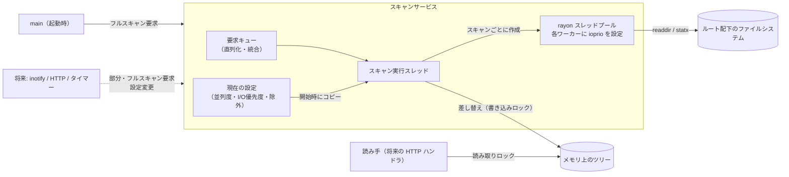
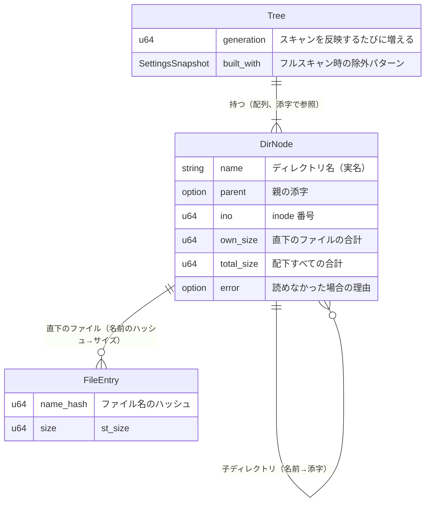
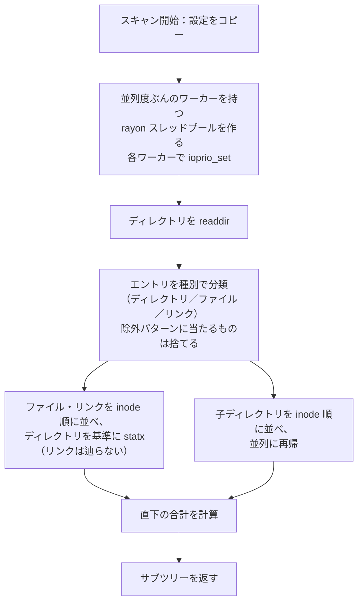

# ディレクトリスキャン 設計ドキュメント

## 1. Overview (概要)

suminoe_file_server が公開するディレクトリツリーについて、各ディレクトリ配下のファイルの合計サイズ（論理サイズ `st_size`）をメモリ上にキャッシュするための、ディレクトリスキャン機構を設計する。対象のルートディレクトリは1つで、スキャンはツリー全体を作り直す「フルスキャン」と、指定したサブツリーだけを読み直す「部分スキャン」の2種類を提供する。

スキャンの並列度と I/O 優先度は、実行中のサーバーに対して内部 API から変更でき、変更は次に開始するスキャンから反映する。並列走査と inode 順の走査は #3 の計測で効果が確認できた手法を採用し、キャッシュが冷えた状態での起動時スキャンを短くしつつ、定期的なスキャンは他の I/O を邪魔しない設定で動かせるようにする。

将来の inotify による差分更新（別 DD）がこのツリーをファイル単位で更新できるよう、ファイルごとに「名前のハッシュ＋サイズ」を保持する。

## 2. Context (背景)

- 本サーバーの目的の1つは、共有フォルダ（sugaga の `/mnt/vgmd0/srv/share`、ディレクトリ 164,717／ファイル約 1,675,021）について、ディレクトリごとの合計サイズを即座に返すことである。リクエストのたびに走査すると、キャッシュが冷えた状態では数十秒〜数分かかる（#3）。
- #3 の計測で分かっていること：
  - キャッシュが冷えた状態の走査時間は、ほぼ HDD（RAID-6、4台）の待ち時間で決まる。`orig` と GNU find はほぼ同じ時間で、コードの書き方による差はほとんどない。
  - 並列化は効く。並列度 4〜8 で orig 比約 49% 短縮し、16 では悪化してばらつきも大きくなる。
  - 子を inode 番号順に辿ると約 18% 短縮する。
  - ext4 の `filetype` 機能により、readdir の時点でエントリの種別が分かる。種別を知るためだけの stat は不要。
  - キャッシュの状態や、同じ `md0` を使う他の LV の I/O によって、走査時間がバッチ間で大きく変動する。
- これまでの計測はディレクトリだけを対象にしていた。サイズを得るにはファイルごとに stat（inode の読み込み）が必要で、その分の I/O が新たに加わる。
- 同じ RAID を CI のキャッシュ（`gitlab-runner-cache`）なども使っているため、定期的なスキャンは低い並列度と idle の I/O 優先度で動かしたい。一方、起動時のスキャンは速く終わらせたい。用途によって設定を変える必要がある。
- inotify による監視（#2）はこの DD の対象外だが、そこでのイベントを反映できる受け口（部分スキャン、ファイル単位のサイズ保持）は、この DD で用意しておく必要がある。

## 3. Scope (範囲)

### 変更対象ファイル

| ファイル | 役割・変更理由 |
|---|---|
| `Cargo.toml` | `rayon`・`globset`・`anyhow`・`log`・`env_logger`・`libc` を追加する。バージョンはパッチまで固定する |
| `src/main.rs` | `env_logger` の初期化、スキャンサービスの起動、起動時のフルスキャン要求を追加する |

### 新規追加ファイル

| ファイル | 役割 |
|---|---|
| `src/dir_scan/mod.rs` | スキャンサービス（要求キュー、スキャン実行スレッド、設定の保持）と、外部に公開する操作 |
| `src/dir_scan/settings.rs` | 並列度・I/O 優先度・除外パターンの設定値と、その検証 |
| `src/dir_scan/tree.rs` | メモリ上のツリー（データモデル）と、部分スキャン結果の差し替え・サイズの伝播 |
| `src/dir_scan/walk.rs` | 1 回のスキャンの走査処理（並列走査、inode 順、除外、エラーの記録） |
| `src/dir_scan/ioprio.rs` | ワーカースレッドへの I/O 優先度の設定（`ioprio_set`） |
| `doc/design/20261101_dir_scan_design.md` | 本 DD |

### 変更対象外

| ファイル | 理由 |
|---|---|
| HTTP ハンドラ（`src/main.rs` の `index` など） | ツリーを HTTP で返す API や、設定を変える外部の操作口は別 DD で扱う |

## 4. Goal (目標)

- **フルスキャンでツリーを構築できる**：ルート配下のディレクトリ・ファイルをすべて走査し、各ディレクトリの合計サイズを得られる。合成ツリーと sugaga の両方で、合計値が `find <root> \( -type f -o -type l \) -printf '%s\n'` の総和（除外パターンを同じにしたもの）と一致する。
- **部分スキャンでサブツリーを差し替えられる**：指定したサブツリーの読み直し結果を反映し、祖先ディレクトリの合計サイズも更新される。ファイルを変更してから部分スキャンした結果が、同じ状態でフルスキャンした結果と一致する。
- **並列度と I/O 優先度を実行時に変えられる**：内部 API で変更した値が、次に開始したスキャンに反映される。スキャン結果のレポートに、使った並列度と I/O 優先度が記録され、ワーカースレッドの I/O 優先度を `ioprio_get` で読み返すと設定値と一致する。
- **キャッシュが冷えた状態でも実用的な時間でフルスキャンできる**：sugaga で、同じバッチの逐次 `du -sb`（キャッシュを冷やしたもの）より、並列度 4 のフルスキャンのほうが短い。

## 5. Non-Goal (目標外)

- **inotify による監視**：監視の設定、イベントの受信・デバウンス、イベントから部分スキャンや差分更新への変換は扱わない（#2、別 DD）。
- **mtime による差分照合**：ディレクトリの mtime で構造のずれだけを検出する照合は扱わない。照合はフルスキャンで行う。
- **外部からの操作口**：ツリーや設定を HTTP や設定ファイルで扱う手段は扱わない。この DD では内部 API までを設計する。
- **スナップショットの永続化と、定期スキャンのスケジューリング**：スキャン結果のディスクへの保存と、いつ定期スキャンを要求するかのタイマーは扱わない。
- **複数ルート、ハードリンクの重複除去、Linux 以外の OS**：ルートは1つ、ハードリンクは名前ごとに数える、対象は Linux のみとする。

## 6. Solution / Technical Architecture (解決策 / 技術アーキテクチャ)

### 6.1 全体像

- スキャンサービスは、要求を受け付けるキューと、要求を1つずつ処理する専用のスキャン実行スレッドからなる。actix-web（tokio）の非同期ランタイムとは別のスレッドで動かし、ランタイムのスレッドをブロックしない。
- スキャンは常に1つずつ実行する（直列化）。実行中に届いた要求はキューで待ち、後述の規則で統合する。
- 設定はスキャンの開始時にコピーして使う。実行中に設定が変わっても、そのスキャンは開始時の設定のまま最後まで走り、新しい設定は次のスキャンから反映される。

### 6.2 内部 API

スキャンサービスは、他のモジュール（main、将来の inotify・HTTP・タイマー）に次の操作を提供する。どれもブロックせずに戻る。

| 操作 | 内容 |
|---|---|
| スキャン要求 | フルスキャン、または部分スキャン（ルートからの相対パス）を要求する。要求ごとに設定を上書きすることもできる（例：起動時だけ並列度 4、best-effort） |
| 設定の取得・変更 | 既定の設定（並列度・I/O 優先度・除外パターン）を読む・置き換える。値が範囲外なら変更を拒否してエラーを返す |
| ツリーの読み取り | 指定したディレクトリの合計サイズと、子ディレクトリごとの合計サイズを読む。読み取りロックの中で完結する |
| スキャン結果の取得 | 直近のスキャンのレポートを読む。種類、開始・終了時刻、ディレクトリ数・ファイル数、エラー数、使った設定、所要時間を含む。同じ内容を `log::info!` にも出す |

設定値の範囲：

| 設定 | 値 |
|---|---|
| 並列度 | 1 以上、上限 64。既定は 4（#3 で最速だった 4〜8 のうち、同じ RAID を使う他の LV への影響が小さいほう） |
| I/O 優先度 | `idle`、または `best-effort` のレベル 0〜7。`realtime` は `CAP_SYS_ADMIN` が必要で、他の I/O を止めうるので受け付けない。既定は `best-effort` 4（カーネルの既定と同じ） |
| 除外パターン | ルートからの相対パスに対する glob の一覧。既定は「名前が `.` で始まるエントリ」 |

### 6.3 要求の直列化と統合

- キューに積まれた要求は、取り出すときに次の規則で統合する。
  - フルスキャン要求が1つでもあれば、待っている部分スキャン要求はすべてそれに含める。
  - 部分スキャン要求のパスが、待っている別の部分スキャン要求のパスの配下なら、外側の要求に含める。
  - 要求ごとに上書きした設定が異なる要求同士は統合しない。
- 除外パターンが前回のフルスキャンから変わっていれば、部分スキャン要求はフルスキャンに格上げする。古いパターンで作られた部分と新しいパターンで作られた部分がツリー内に混ざらないようにするため。

### 6.4 データモデル

- **ディレクトリ**は実名を持つ。部分スキャンや将来の inotify のイベントでは「パス → ディレクトリ」の引き当てが必要になるため。ディレクトリは約 16.5 万件なので、メモリは小さい（概算 30MB 未満）。
- **ファイル**は「名前のハッシュ → サイズ」だけを持つ。将来の inotify によるファイル単位の更新では、イベントに含まれる名前のハッシュで古いサイズを引き、差分を祖先に伝えられる。削除やツリー内での移動は I/O なしで反映でき、書き込みや作成も対象ファイル1個の stat で済む。ファイル名の一覧は返せないが、目的（サイズのキャッシュ）には不要。約 167 万件で概算 30〜40MB。
- **シンボリックリンク**は辿らず、リンク自身の `lstat` のサイズを1ファイルとして数える（`du -sb` と同じ扱い）。
- **ハードリンク**は名前ごとに数える。重複は除かない。
- 合計サイズはディレクトリ自身のサイズ（ディレクトリエントリのブロック）を含めず、ファイルとシンボリックリンクの `st_size` の和とする。
- ハッシュは、プロセス内だけで使う決定的なハッシュ関数を使う（ディスクには保存しないので、Rust のバージョン間で値が変わっても問題ない）。

### 6.5 1 回のスキャンの走査

- 種別は readdir の結果（d_type）から判定し、種別のためだけの stat はしない。ext4 以外で種別が返らない（`DT_UNKNOWN`）場合だけ、そのエントリを stat する。
- ファイルの stat は、開いているディレクトリを基準に名前で行い（`fstatat` 相当）、ルートからのフルパスを毎回解決しない。
- ファイルと子ディレクトリは、どちらも inode 番号順に処理する。子ディレクトリは rayon の並列イテレータに渡すため、作業の奪い合いで実際の順序は一部崩れるが、各ワーカー内での局所性は残る。
- **エラーの扱い**：test/dir_scan/1 には「エントリ1つの失敗でディレクトリごと消える」問題があった。これを避け、次のようにする。
  - 読めないディレクトリ（権限なしなど）は、エラー理由を付けてツリーに残し、合計 0 として扱う。サブツリーは落とさない。
  - readdir と stat の間に消えたファイル（`ENOENT`）は数えずに進む。
  - エラーは件数をレポートに数え、ディレクトリごとの理由は `log::warn!` に出す。致命的でないエラーは処理を止めない。
- スキャン中にファイルが変わった場合、そのスキャン結果はある時点の正確なスナップショットにはならない。この不整合は、次のスキャン（将来は inotify のイベント）で解消する前提とする。

### 6.6 ツリーへの反映

- スキャンは、新しいツリー（フル）またはサブツリー（部分）を、既存のツリーとは別に組み立てる。組み立て中は既存のツリーに触らないので、読み手は待たされない。
- 組み立てが終わったら書き込みロックを取り、次のように反映する。
  - フルスキャン：ツリー全体を置き換える。
  - 部分スキャン：対象ディレクトリのサブツリーを差し替え、`total_size` の差分を祖先すべてに伝える。対象パスがツリーに無ければ、親ディレクトリの子として追加する。実体が消えていれば、サブツリーを削除する。
- 反映のたびに `generation` を増やす。将来の inotify の DD で、「スキャン開始後に届いたイベント」を再適用するときの基準に使えるようにするため。

### 6.7 I/O 優先度の適用

- スキャンごとに作るスレッドプールの、各ワーカースレッドの開始時に `ioprio_set` を呼び、そのスレッドの I/O 優先度を設定する。プロセス全体の優先度は変えないので、HTTP を処理するスレッドには影響しない。
- `libc` に `ioprio_set` のラッパーはないので、システムコールを直接呼ぶ。失敗したらログに出して、カーネルの既定の優先度のまま続ける。スキャン自体は止めない。
- スレッドプールはスキャンが終われば破棄する。スキャンの時間（数十秒〜）に比べて、スレッドを作るコストは無視できる。

### 6.8 起動時の動作

- main は起動時にスキャンサービスを立ち上げ、並列度 4、`best-effort` のフルスキャンを要求する。HTTP サーバーはスキャンの完了を待たずに起動する。
- 最初のフルスキャンが終わるまでは、ツリーは空（スキャン未完了）として扱い、読み手にもそれが分かるようにする。

## 7. Alternative Solution (代替案)

### 代替案1: 並列化の方式

1. **スキャンごとに rayon のスレッドプールを作る（採用）**
   - **Pros**：並列度の変更が「次のスキャンから」という方針と自然に合う。ワーカーごとに I/O 優先度を設定できる。#3 の計測で使った方式と同じ。
   - **Cons**：作業の奪い合いで inode 順が一部崩れる。
2. **ツリーの階層ごとに全ディレクトリを inode 順に並べ、固定数のワーカーで処理する**
   - **Pros**：inode 順の局所性を保ったまま、同時に複数の要求を出せる。
   - **Cons**：実装が複雑になる。効果は未計測で、#3 の考察で「やらない」と判断した。
3. **tokio の `spawn_blocking` で走査する**
   - **Pros**：既存の非同期ランタイムに乗れる。
   - **Cons**：ブロッキング用のスレッドプールは他の処理と共有されるので、スレッド単位の I/O 優先度を設定できない。並列度も制御しにくい。
- **判断**：1 を採用する。2 は、起動時の時間が問題になったときに改めて検討する。

### 代替案2: ファイルごとに保持する情報

1. **名前のハッシュ＋サイズ（採用）**
   - **Pros**：将来の inotify のイベントを I/O 最小で反映できる。メモリは約 30〜40MB で済む。
   - **Cons**：ファイル名の一覧は返せない。ハッシュの衝突はありうる（6.4、8 を参照）。
2. **名前（実名）＋サイズ**
   - **Pros**：ファイル一覧も返せる。衝突の心配がない。
   - **Cons**：メモリが約 80〜150MB 必要になる。現時点の目的には不要。
3. **ディレクトリごとの合計だけを持つ**
   - **Pros**：メモリが最小。
   - **Cons**：ファイルの変更を差分で反映できず、イベントのたびに兄弟ファイルをすべて stat し直すことになる。
- **判断**：1 を採用する。ファイル名が必要になったら、2 への切り替えを検討する。

### 代替案3: 読み手への公開方法

1. **書き込みロック（`std::sync::RwLock`）の中で差し替える（採用）**
   - **Pros**：部分スキャンでも、差し替える部分だけを変更できる。組み立てはロックの外で行うので、書き込みロックを持つのは短時間。
   - **Cons**：反映の瞬間だけ読み手が待つ。
2. **ツリー全体を複製し、ポインタを差し替える（`Arc` の入れ替え）**
   - **Pros**：読み手は一切待たない。
   - **Cons**：部分スキャンのたびに、数十 MB のツリー全体を複製することになる。
3. **永続データ構造（構造共有のある不変ツリー）**
   - **Pros**：複製のコストが小さく、読み手も待たない。
   - **Cons**：実装と依存が複雑になり、「愚直で平易なコード」の方針に反する。
- **判断**：1 を採用する。

### 代替案4: 設定変更を反映する時期

1. **次のスキャンから（採用）**
   - **Pros**：実行中のスキャンのスレッド数や優先度を動的に変える仕組みが不要で、単純。
   - **Cons**：長いスキャンの途中で設定を変えても、すぐには効かない。
2. **実行中のスキャンにも反映する**
   - **Pros**：負荷が問題になったとき、すぐに絞れる。
   - **Cons**：ワーカーの動的な増減と、優先度の再設定の仕組みが必要になる。
- **判断**：1 を採用する。すぐに止めたい場合のためのキャンセルは、必要になってから検討する。

### 代替案5: I/O を絞る手段

1. **ワーカースレッドごとの `ioprio_set`（採用）**
   - **Pros**：スキャンのスレッドだけを対象にできる。権限が要らない（`idle`／`best-effort` の範囲なら）。
   - **Cons**：I/O スケジューラが優先度を扱う場合（BFQ など）にしか効かない。dm-thin と md を経由すると、優先度が伝わらない可能性がある（8 を参照）。
2. **プロセス全体の `ionice`**
   - **Pros**：設定が簡単。
   - **Cons**：HTTP の処理の I/O も一緒に下がる。
3. **cgroup の I/O 制御（`io.max`、`io.weight`）**
   - **Pros**：帯域や IOPS の上限で、確実に絞れる可能性がある。
   - **Cons**：systemd での委譲など、運用側の準備が必要。スレッド単位では効かない。
- **判断**：1 を採用する。sugaga で効かないことが分かったら、3 を検討する。

## 8. Concerns (懸念事項)

- **I/O 優先度が sugaga で効かない可能性**：sugaga の構成は ext4 → LVM thin → md RAID-6 → HDD 4 台。優先度が効くには、I/O スケジューラが優先度を扱うこと（BFQ、または mq-deadline のクラス対応）と、dm-thin と md の raid456 が発行し直す I/O に優先度が引き継がれることの両方が必要で、どちらも未確認。
  - 緩和策：実装後に、別プロセスで連続読み込みを流しながら、`idle` と `best-effort` のスキャン時間・相手の読み込み速度を比べて効果を確認する。効かなければ、代替案5 の 3（cgroup）を検討する。
- **ファイルの stat を含めたフルスキャンの時間が未計測**：#3 の計測はディレクトリだけだった。約 167 万ファイルの inode を読むコストが加わる。
  - 緩和策：同じ条件での `du -sb` の時間で見積もれる（`sync; echo 3 > /proc/sys/vm/drop_caches; time du -sb <root>`）。極端に長ければ、起動時の並列度を上げるか、スナップショットの永続化（別 DD）を優先する。
- **メモリ使用量**：ディレクトリとファイルで、合わせて概算 60〜70MB。sugaga のメモリで許容できるかを、実装後に実測で確認する。
- **ファイル名のハッシュの衝突**：同じディレクトリ内で衝突すると、2 つのファイルのサイズが混ざる。64 ビットのハッシュでは、10 万ファイルのディレクトリでも衝突確率は約 3×10⁻¹⁰ で、無視できる。
  - 緩和策：衝突は検出できないので、フルスキャンによる定期的な作り直しで、ずれが残り続けないようにする。
- **スキャン中の変更**：スキャン中に変更されたファイルの反映は、スキャンのタイミング次第で漏れたり古くなったりする。将来の inotify の DD で、`generation` を基準にスキャン開始後のイベントを再適用して解消する。
- **読めないディレクトリ**：サーバーを動かすユーザーの権限で読めないディレクトリ（sugaga では `disk-images/Windows10/1511/...` 配下の 4 つ）は、合計に含まれない。エラーとしてツリーに残るので、読み手から分かる。
- **CI が未整備**：`cargo fmt --check` と `cargo clippy --tests --examples -- -Dclippy::all` をローカルで通すことにする。CI の整備は別途行う。

## 10. Safety and Reliability (安全性と信頼性)

- **テストの実施**：
  - ユニットテストでは、テストごとに一時ディレクトリにツリーを作り、次の点を確認する。
    - フルスキャンの合計値
    - 部分スキャンの差し替えと、祖先へのサイズの伝播
    - 除外パターン
    - シンボリックリンクを辿らないこと
    - 読めないディレクトリをエラーとして残すこと
    - 要求の統合規則
    - 設定値の検証
  - 要求の統合規則と設定値の検証は、ファイルシステムに触れない純粋なロジックとして切り出し、I/O なしでテストする。
  - E2E テストでは、合成ツリー（#3 で使ったもの）と sugaga の実データで、合計値を `find -printf '%s'` の総和と比べる。
- **テストカバレッジの計測**：`cargo llvm-cov` で計測し、80% 以上にする。
- **静的型付け言語の採用**：Rust で実装する。設定値は範囲を検証する型で受け取り、範囲外の値は変更 API で拒否する。

## 11. References (参考資料)

- [#2 ファイルシステムの監視機構に使えそうなものを調べる](https://github.com/yumetodo/suminoe_file_server/issues/2)：inotify による監視の検討
- [#3 directory scanの性能を調べる](https://github.com/yumetodo/suminoe_file_server/issues/3)：走査の計測結果と考察（Hyper-V VM と sugaga）
- [`test/dir_scan/2` ブランチ](https://github.com/yumetodo/suminoe_file_server/tree/test/dir_scan/2)：計測に使った走査方式の比較ツール
- [ioprio_set(2)](https://man7.org/linux/man-pages/man2/ioprio_set.2.html)：スレッド単位の I/O 優先度
- [rayon::ThreadPoolBuilder](https://docs.rs/rayon/latest/rayon/struct.ThreadPoolBuilder.html)：スレッドプールの作成と、ワーカー開始時の処理
- [globset](https://docs.rs/globset/latest/globset/)：除外パターンの照合
- [inotify(7)](https://man7.org/linux/man-pages/man7/inotify.7.html)：将来の差分更新で使うイベントの種類
- [ext4 のマウントオプション（`inode_readahead_blks`）](https://docs.kernel.org/admin-guide/ext4.html)：inode 順の走査が効く理由の推測の根拠

## 12. Work Log  (作業ログ)

### 2026-11-01

- スキャンの目的が「ディレクトリ配下のファイルサイズのキャッシュ」であることを確認し、ノードにファイルも含めることにした。
- ファイルごとには「名前のハッシュ＋論理サイズ（`st_size`）」を持つことにした。将来の inotify によるファイル単位の更新を、I/O 最小で反映できるため。
- ハードリンクは名前ごとに数える。ルートは1つとする。
- 並列度・I/O 優先度を変える手段は、DD では内部 API までに抽象化し、外部の操作口は別 DD とした。設定の変更は次のスキャンから反映する。
- スキャンの種類はフルスキャンと部分スキャンとした。mtime による差分照合は、ファイルの中身の変更によるサイズのずれを検出できないため対象外にした。
- 除外パターンは設定で指定できるようにし、シンボリックリンクは辿らないことにした。
- スキャン同士は直列化し、待っている要求は統合する。
